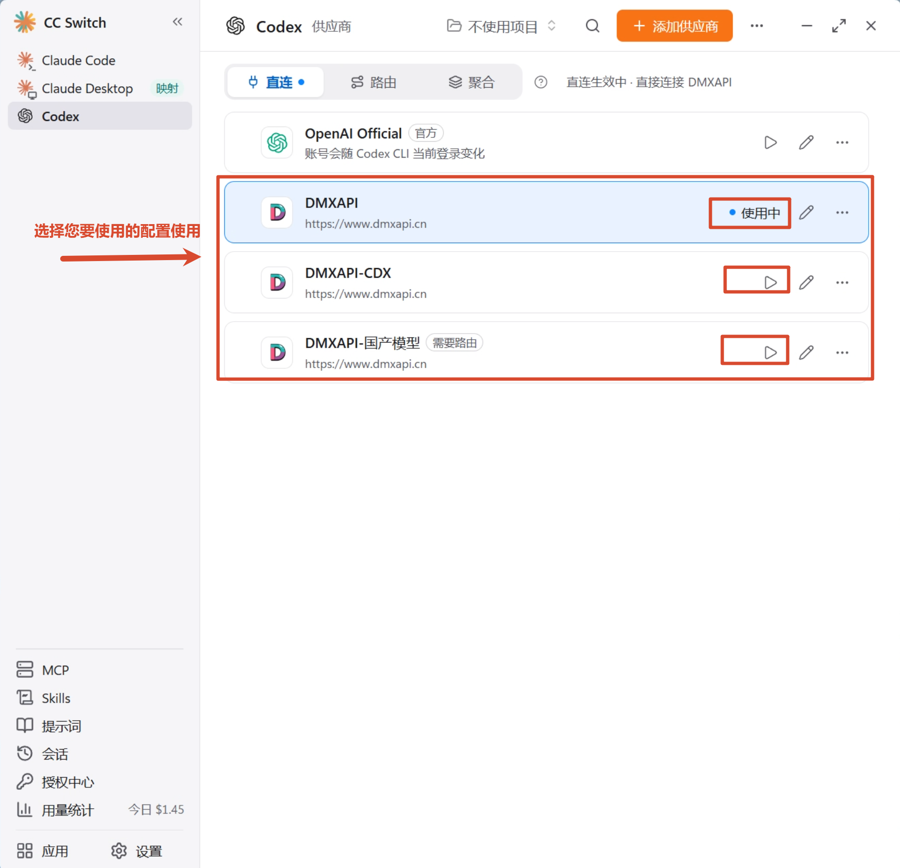
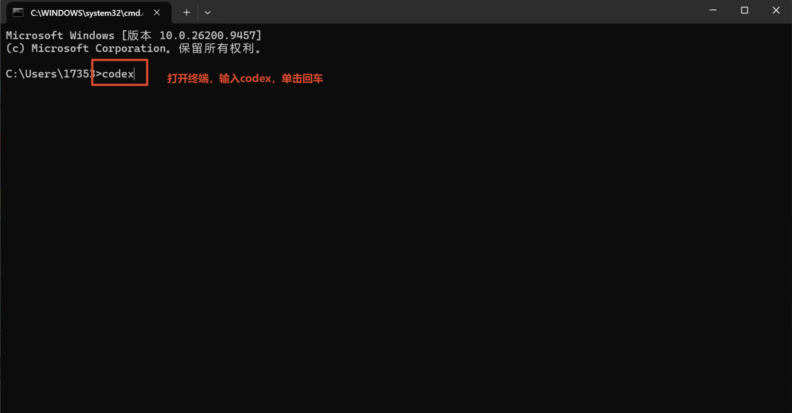
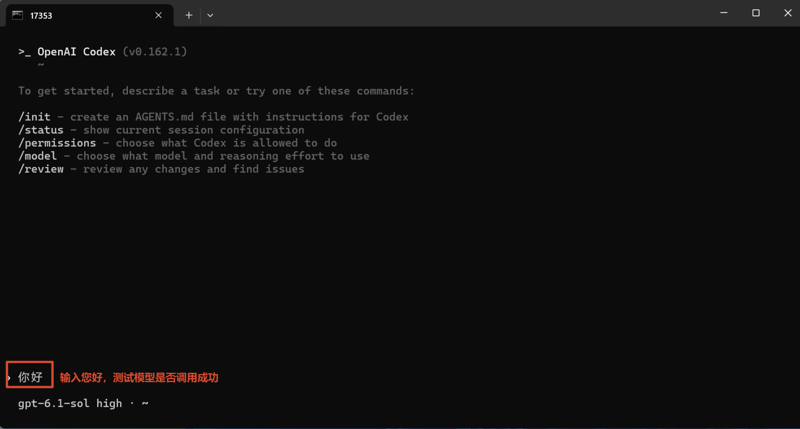
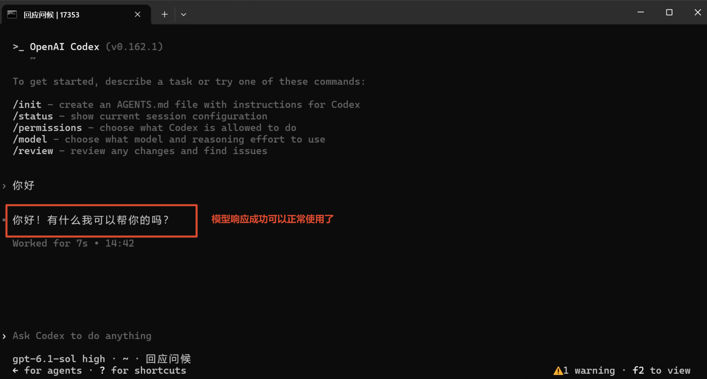

# CC Switch 配置 Codex CLI 教程

CC-Switch 是一款面向开发者的多供应商配置切换工具，可在 Claude Code、Codex 等多种客户端之间一键切换不同的 API 厂商与模型。本文介绍如何使用 CC Switch 将 **Codex（CLI）** 接入 DMXAPI。

本教程包含三个专题，按您要使用的模型类型选择其中一个进行配置即可：

- **DMXAPI(gpt原生支持)**：使用 GPT 系列原生模型（Responses API 直连）
- **DMXAPI(codex专区配置)**：使用 codex 专区模型（`-cdx` 后缀，如 `gpt-6.1-sol-cdx`）
- **DMXAPI(国产模型配置)**：使用国产模型（如 `deepseek-v4.1-flash`、`glm-5.3`），通过 Chat Completions 协议接入

## 环境准备

在开始之前，请先完成以下准备：

- 下载 **CC Switch** 工具：前往 [CC Switch 官网](https://ccswitch.io/zh/) 下载并安装。
- 准备一个 DMXAPI 令牌（API Key），可在 [DMXAPI 控制台](https://www.dmxapi.cn/keys) 的「API 令牌」页获取。

## 检查更新

在正式配置前，请先确认 Codex CLI 为最新版本，避免因版本过旧导致配置不生效。

### 步骤 1：打开安装与升级

打开 CC Switch，按截图中的编号操作：

- ① 点击右上角的 **「...」** 按钮
- ② 在弹出的菜单中点击 **「安装与升级」**

### 步骤 2：检查更新

进入「应用」页面：

- ① 点击右上角的 **「检查更新」**，查看对应配置软件（Codex）是否是最新版本，如有新版本请先升级再继续配置

## 配置供应商

### 步骤 1：选择 Codex 并添加供应商

回到 CC Switch 主界面：

- ① 点击左侧的 **Codex** 选项卡
- ② 点击右上角橙色 **「添加供应商」** 按钮

### 步骤 2：选择预设供应商 DMXAPI

进入「添加新供应商」页面，按编号操作：

- ① 在搜索栏中搜索 **DMXAPI**
- ② 点击选择 **DMXAPI** 预设

## DMXAPI(gpt原生支持)

本专题适用于直接使用 **GPT 系列原生模型**（如 `gpt-6.1-sol`），上游走 Responses API 直连，无需模型映射。

### 步骤 1：填写供应商信息

在供应商配置表单中按编号依次操作：

- ① **API Key**：填入您的 DMXAPI 令牌
- ② **名称**：自定义供应商名称，例如 `DMXAPI`（名称仅用于区分不同配置）
- ③ **API 请求地址**：检查为 `https://www.dmxapi.cn/v1`
- ④ **默认模型**：建议修改为 `gpt-6.1-sol`
- ⑤ 确认无误后点击右下角的 **「保存」** 完成配置

配置完成后，跳转到下文 [选择配置并启用](#选择配置并启用) 启用该配置即可。

## DMXAPI(codex专区配置)

本专题适用于使用 **codex 专区模型**（`-cdx` 后缀，如 `gpt-6.1-sol-cdx`），需要在「模型列表」中添加专区模型。

### 步骤 1：创建带模型限制的令牌

登录 DMXAPI 官网，进入 **工作台 → 令牌** 页面，创建 API 密钥：

- ① **名称**：自定义令牌名称，例如 `DMXAPI-CDX`
- ② 打开 **高级设置**，在 **模型限制** 中加上您要使用的 `-cdx` 模型，例如 `gpt-6.1-sol-cdx`（令牌仅能使用选定的模型，防止误调用其他模型）
- ③ 最后点击 **「保存更改」**

### 步骤 2：填写供应商信息

回到 CC Switch，重新点击 **「添加供应商」** 并选择 DMXAPI 预设，在配置表单中按编号依次操作：

- ① **API Key**：填入上一步创建的 DMXAPI 令牌
- ② **名称**：自定义供应商名称，例如 `DMXAPI-CDX`
- ③ **API 请求地址**：检查为 `https://www.dmxapi.cn/v1`
- ④ 点击 **「获取模型列表」** 检验模型连通性

### 步骤 3：添加并配置模型

在「模型列表」区按编号依次操作：

- ① 如果令牌进行了上一步的模型限制，可以直接点击 **「选择模型」** 一键添加并进行配置
- ② 也可以点击 **「手动添加」** 逐条添加模型
- ③ 配置 codex 专区您使用的模型：在 **菜单显示名 / 实际请求模型** 中输入专区模型名称（如 `gpt-6.1-sol-cdx`），并填入对应的 **上下文窗口**（如 `872000`）
- ④ 确认无误后点击右下角的 **「添加」**

### 步骤 4：配置思考等级和上下文窗口

点击模型行的 **「思考等级」** 下拉框，配置模型支持的思考等级和上下文窗口：

- 勾选模型支持的思考等级（如 `low`、`medium`、`high`、`xhigh`、`max`、`ultra`）
- 在下方 **「默认等级」** 中选择默认的思考等级

::: warning 注意
请先确认所选模型是否支持对应的思考等级（low/high/max 等思考深度控制），再进行开启。
:::

配置完成后，跳转到下文 [选择配置并启用](#选择配置并启用) 启用该配置即可。

## DMXAPI(国产模型配置)

本专题适用于使用 **国产模型**（如 `deepseek-v4.1-flash`、`glm-5.3`），上游走 **Chat Completions** 协议，需要开启 CC Switch 的本地路由才能转换为 Codex 可用的格式。

### 步骤 1：创建带模型限制的令牌

登录 DMXAPI 官网，进入 **工作台 → 令牌** 页面，创建 API 密钥：

- ① **名称**：自定义令牌名称，例如 `DMXAPI-国产模型`
- ② 打开 **高级设置**，在 **模型限制** 中选择您要配置的模型，例如 `deepseek-v4.1-flash`、`glm-5.3`、`kimi-k3` 等
- ③ 最后点击 **「保存更改」**

### 步骤 2：填写供应商信息

回到 CC Switch，重新点击 **「添加供应商」** 并选择 DMXAPI 预设，在配置表单中按编号依次操作：

- ① **API Key**：填入上一步创建的 DMXAPI 令牌
- ② **名称**：自定义供应商名称，例如 `DMXAPI-国产模型`
- ③ **API 请求地址**：检查为 `https://www.dmxapi.cn/v1`

然后在 **「模型列表」** 区配置您使用的模型（可通过 **「选择模型」** 一键配置或 **「手动添加」**），为每个模型填入 **菜单显示名 / 实际请求模型**、**上下文窗口**（如 `1000000`）和 **思考等级**。

### 步骤 3：设置上游格式并保存

继续在表单中向下操作：

- ① 如果配置了模型限制，可以点击 **「选择模型」** 一键配置
- ② 也可以点击 **「手动添加」** 手动添加配置
- ③ 检查模型配置是否正确
- ④ 展开 **「高级选项」**，**上游格式**选择 **Chat Completions（需转换）**
- ⑤ 确认无误后点击右下角的 **「添加」**

::: warning 注意
直连模式下用不了 Chat Completions 格式，启用该配置时需要切到 **路由** 或 **聚合** 模式才能使用。
:::

配置完成后，跳转到下文 [选择配置并启用](#选择配置并启用) 启用该配置即可。

## 选择配置并启用

回到 Codex 供应商主界面：

- 在 DMXAPI 系列供应商卡片上，点击您要使用的配置的 **「启动」** 按钮进行启用切换（如 `DMXAPI`、`DMXAPI-CDX`、`DMXAPI-国产模型`）

::: tip 提示
- 启用 **国产模型** 配置时会弹出「需要路由」提示，选择 **「开始路由并使用它」** 即可开启本地路由并切换。
- 启用 **codex 专区** 或 **国产模型** 配置后，模型列表有修改时需要重启 Codex 使配置生效。
:::

启用后，恭喜你完成配置！接下来启动 Codex 验证效果。

## 启动演示

#### 1、打开终端，输入 codex 启动

> 打开终端，输入 `codex` 后回车启动 Codex CLI。

#### 2、在对话框中输入"你好"，测试模型是否调用成功

#### 3、模型响应成功，可以开始使用了

  <small>© 2026 DMXAPI CC Switch 配置 Codex CLI 教程</small>

