# Cherry Studio 移动端同步桌面端配置
Cherry Studio 移动端支持通过「设备互联」与桌面端配对，直接同步桌面端已配置好的服务商和模型，无需在手机上重新填写 API 地址和密钥。

::: warning 版本要求
Cherry Studio 移动端 **v2.0** 版本需要配合桌面端 **v2.1.3 及以上** 版本使用，建议移动端和桌面端都更新到最新版。
:::

::: tip 开始前准备
手机端同步的是桌面端已配置好的服务商和模型，开始前请先完成以下准备：
- 参考 [Cherry Studio 快速开始](/cherry-studio-fast-start)，在桌面端配置 DMXAPI 服务商并添加模型
- 如需使用 Claude、GPT、Gemini 系列模型（或以 `-cc` 结尾的模型），参考 [Cherry Studio 对话模型格式切换](/cherry-studio-model-format)，在桌面端按文档填写各协议端点并设置这些模型的对话格式
- 确保手机和电脑连接在 **同一局域网** 内
:::

## 手机端：选择从桌面端同步
### 第一步 同意隐私与数据
打开 Cherry Studio 移动端，在 **隐私与数据** 弹窗中点击 **同意并继续**。

### 第二步 从桌面端同步
在欢迎页点击 **从桌面端同步**。
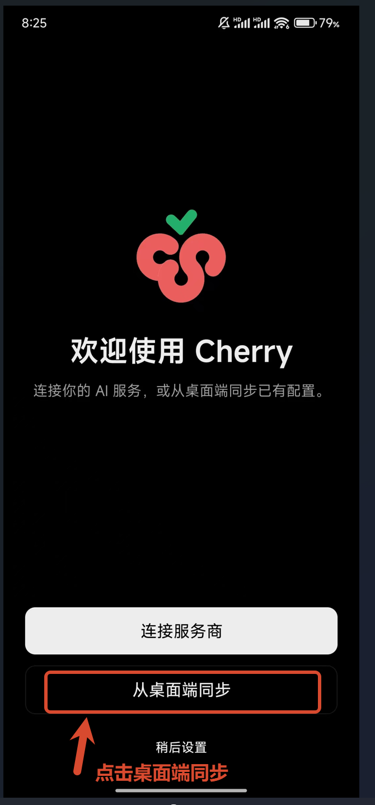

## 桌面端：开启设备互联
### 第一步 打开设置
打开 Cherry Studio 桌面端，点击左下角 **设置** 图标。
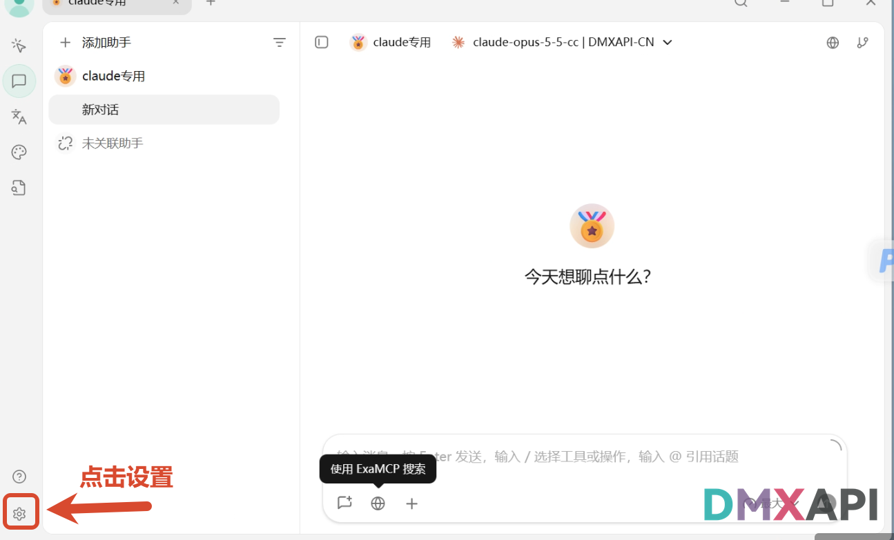
### 第二步 进入设备互联
1. 点击左侧 **设备互联**  
2. 开启设备互联：若显示「设备互联未开启」，需先点击右侧 **前往 API 网关设置** 启动网关
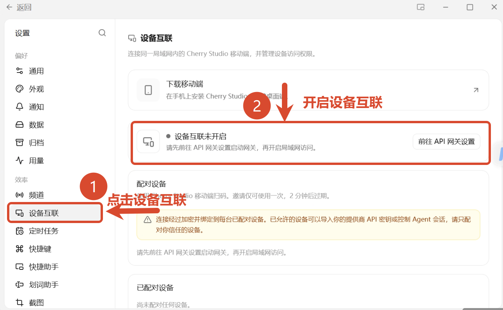
### 第三步 启动 API 网关
在 **API 网关** 页面点击右上角的 **启动** 按钮。
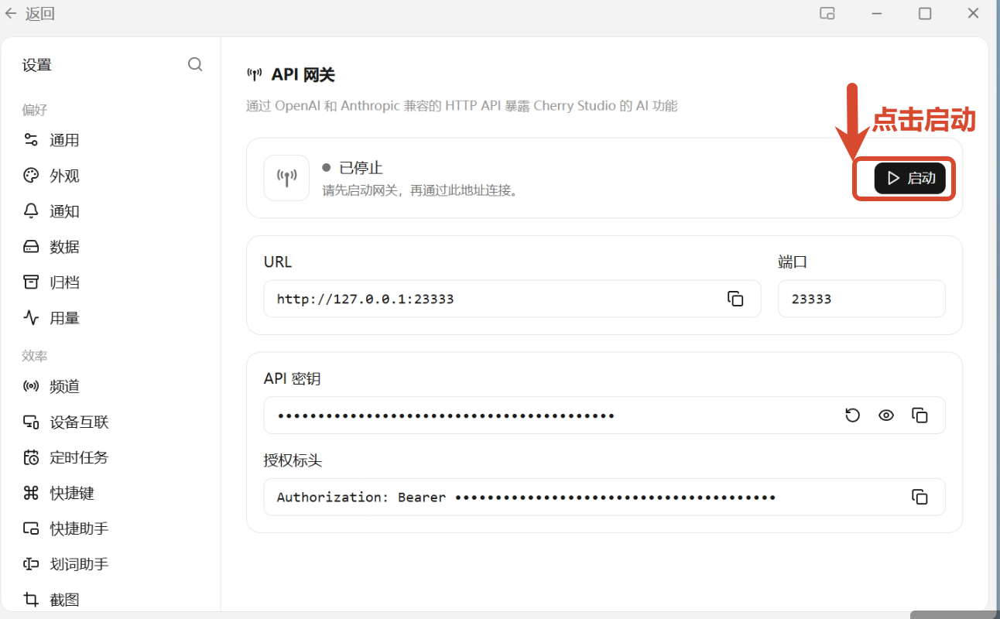
### 第四步 开启局域网并显示配对二维码
1. 点击左侧 **设备互联** 返回，开启局域网访问。状态显示为「可以连接设备」即表示开启成功，此时按钮会变为 **关闭局域网访问**  
2. 点击 **显示配对二维码**
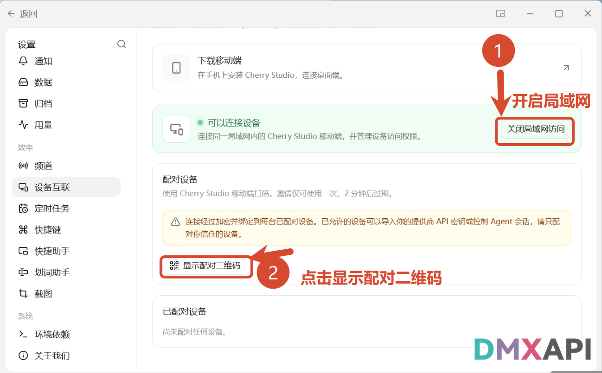

## 配对设备
### 第一步 手机端核对验证码
用手机扫描电脑上显示的配对二维码，手机上会生成一组验证码并提示「等待电脑确认」，这组验证码需要和电脑端核对。  
配对二维码仅可使用一次，2 分钟后过期，过期后需在电脑端重新生成配对二维码。
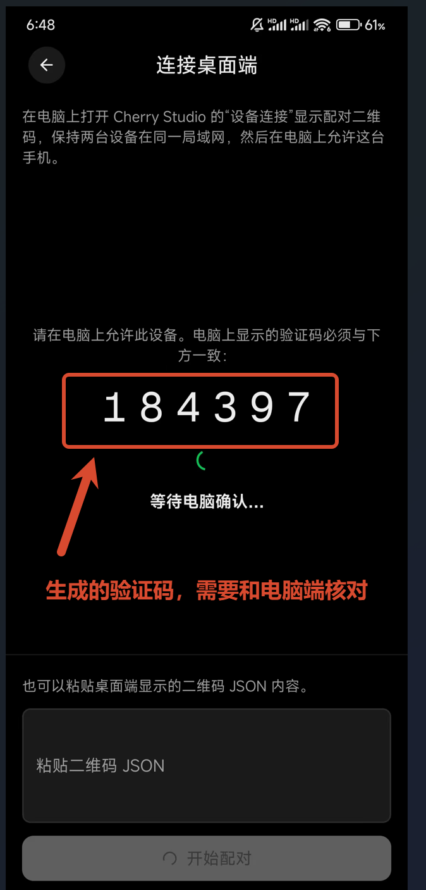
### 第二步 桌面端允许配对
电脑端的 **配对设备** 中会出现手机的设备信息和验证码。确认验证码与手机上显示的一致，并保持勾选 **导入提供商和模型**，然后点击 **允许**。请只配对你信任的设备。
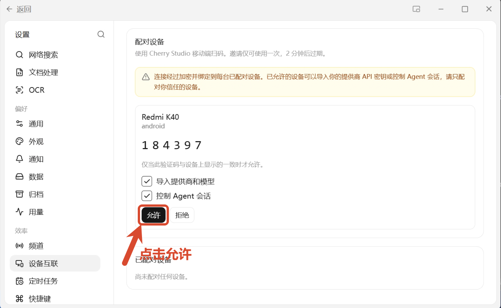

## 手机端：同步服务商和模型
### 第一步 选择并同步服务商
1. 点击选择要同步的服务商，例如 `DMXAPI-CN`  
2. 点击 **同步 1 个服务商**（数字为已选服务商的数量）

同步会覆盖手机端所选服务商的地址和密钥，已有模型会保留。
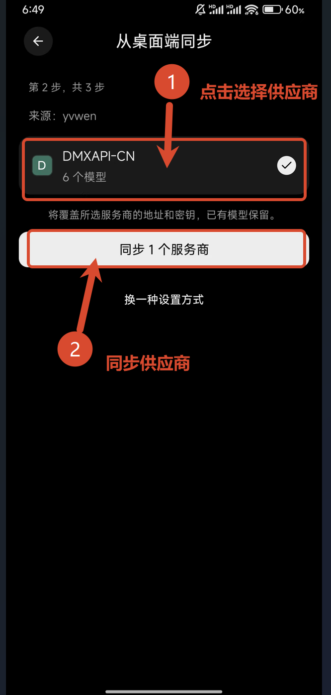
### 第二步 选择聊天模型
1. 可以在顶部搜索框直接搜索需要的模型  
2. 在列表中选择一个要使用的模型  
3. 点击底部的 **开始聊天**

开始前会检查连接，可能产生少量费用。
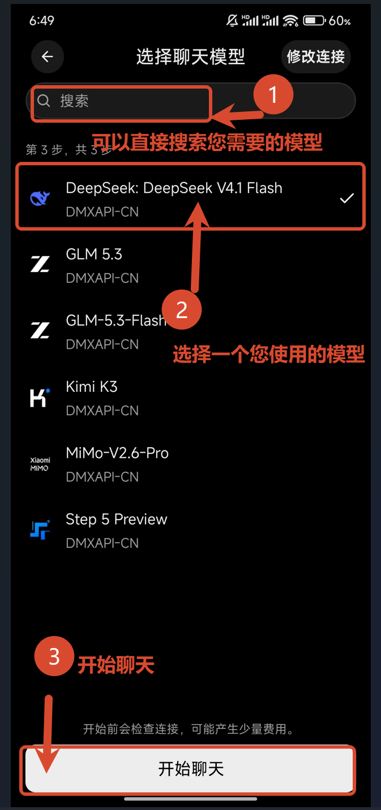

## 开始聊天
### 第一步 输入问题
在底部输入框输入问题，例如「你好」，然后点击发送。
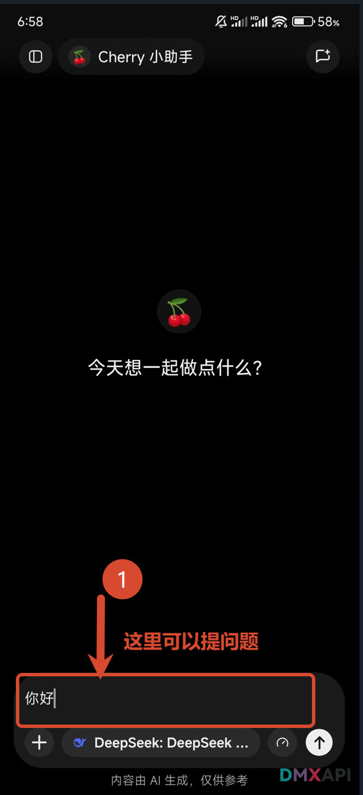
### 第二步 正常使用
模型正常回复即表示同步成功，可以在手机上正常使用了。
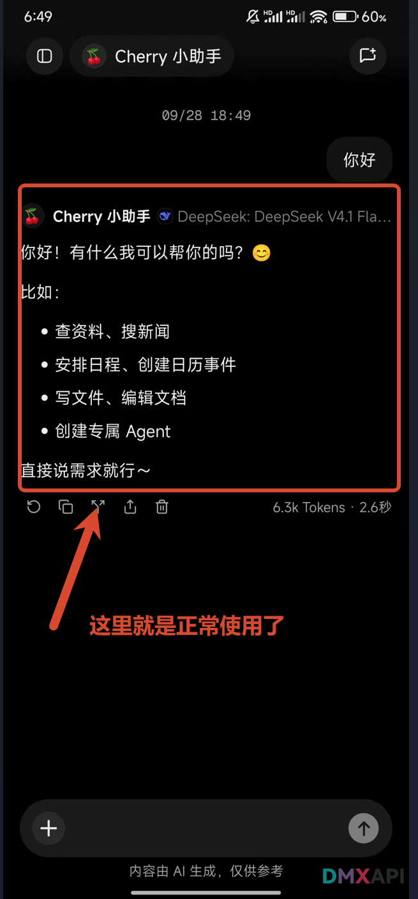

  <small>© 2026 DMXAPI Cherry Studio 移动端同步桌面端配置</small>

