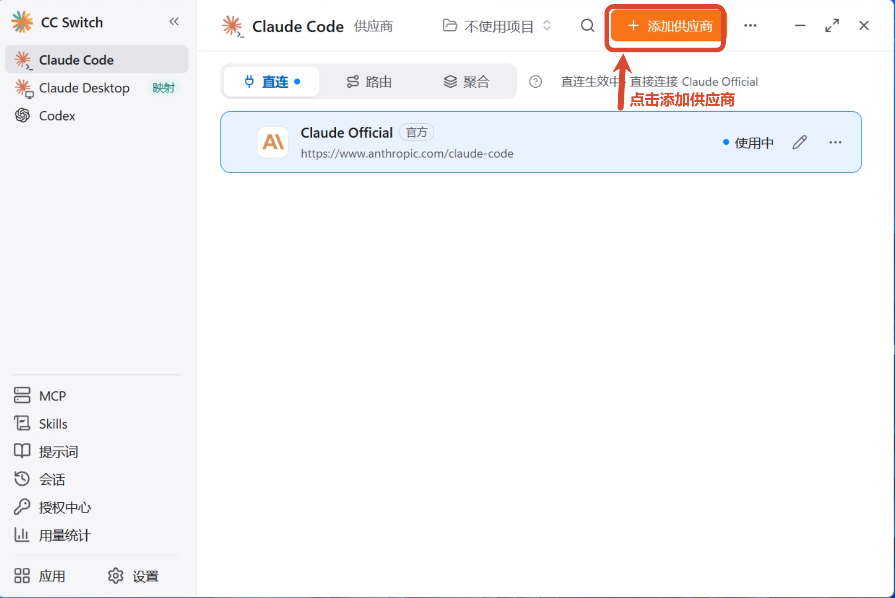
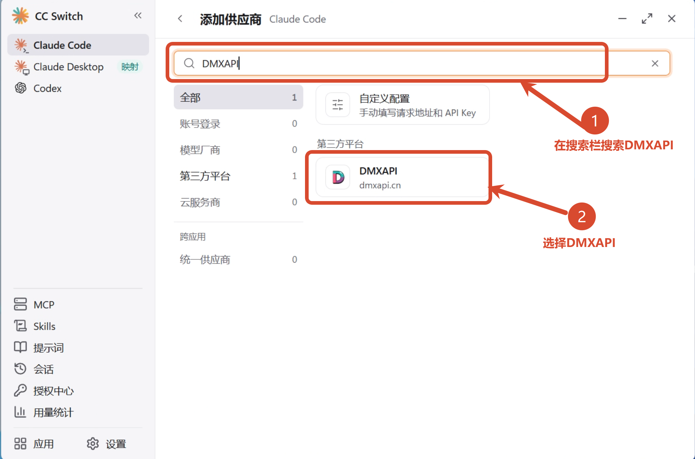
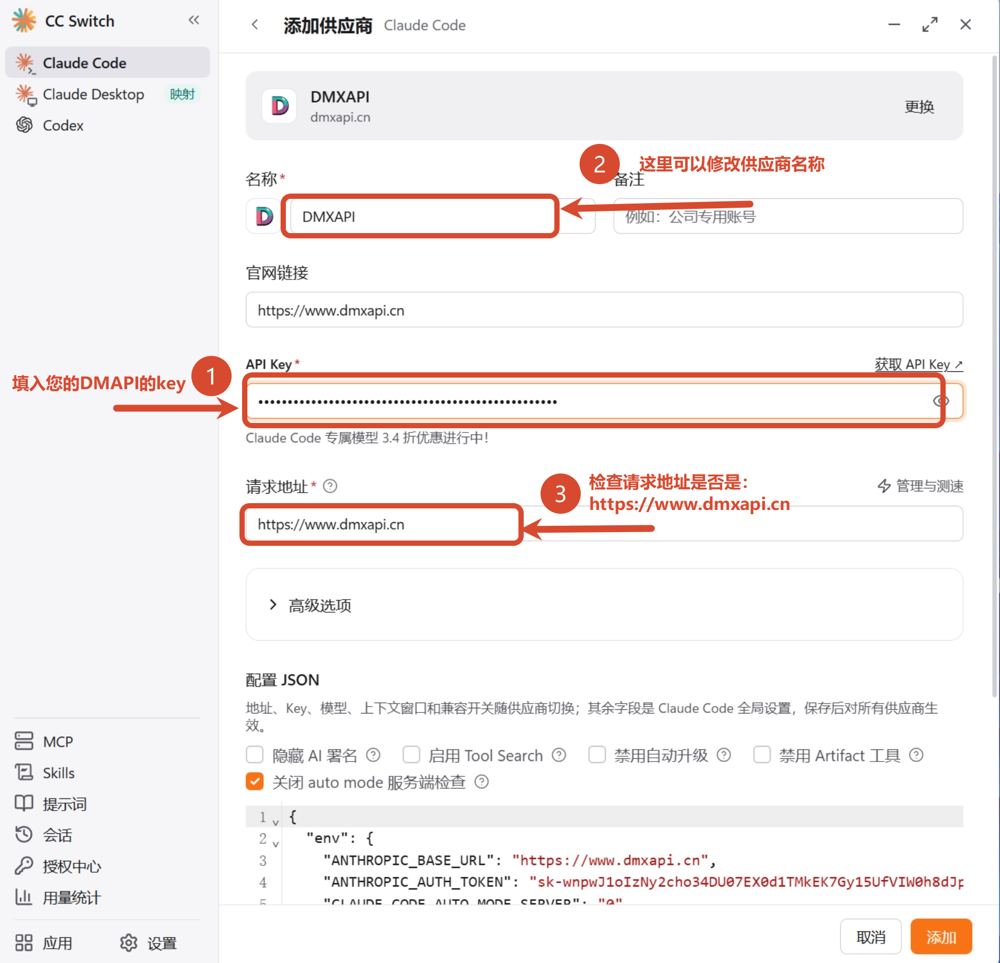
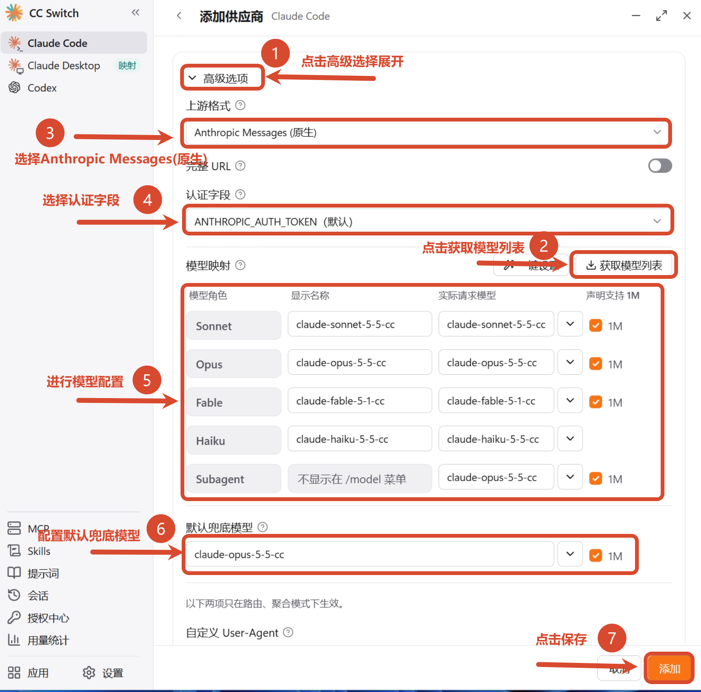
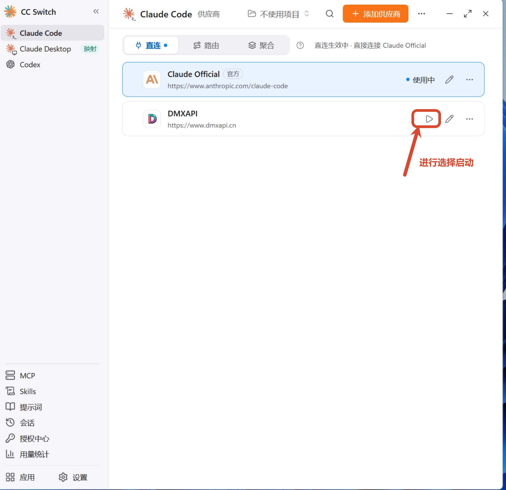
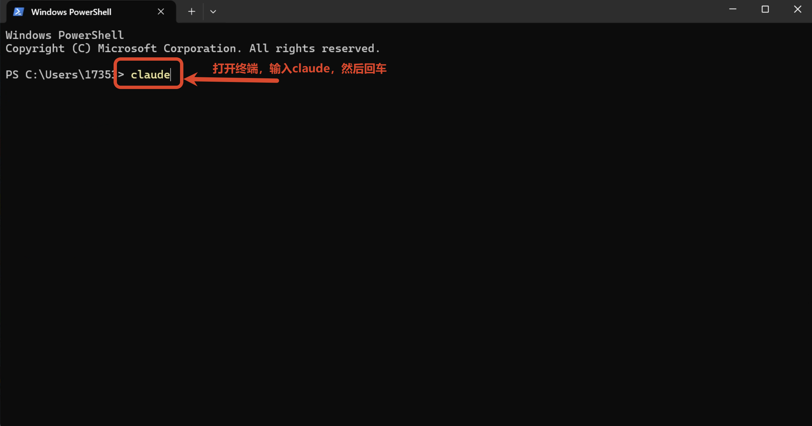
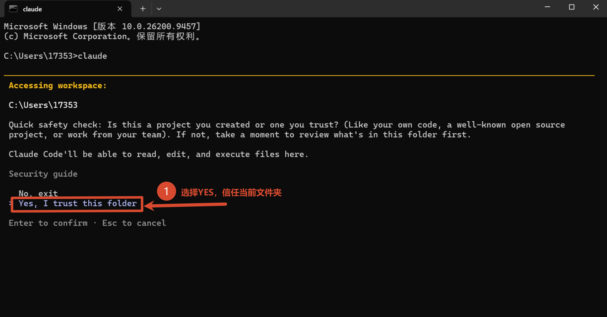
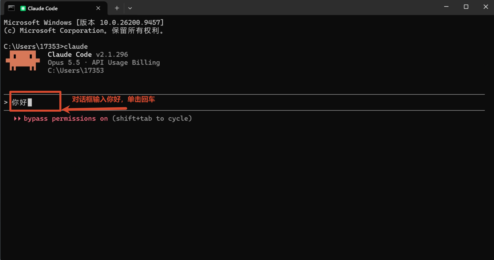
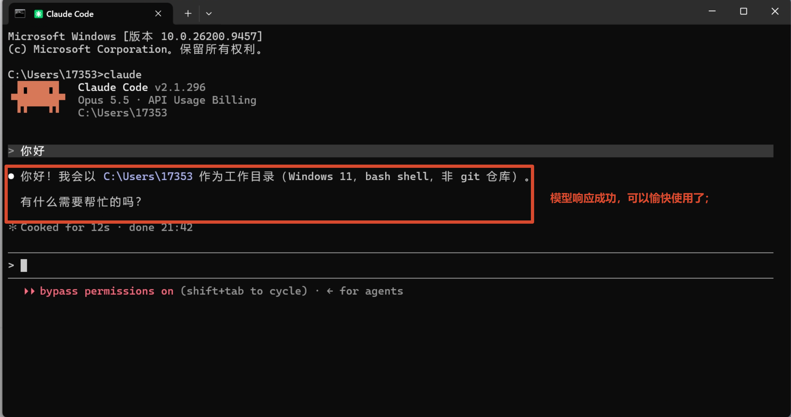

# CC Switch 配置 Claude Code 教程

CC-Switch 是一款面向开发者的多供应商配置切换工具，可在 Claude Code、Codex 等多种客户端之间一键切换不同的 API 厂商与模型。本文介绍如何使用 CC Switch 将 **Claude Code（CLI）** 接入 DMXAPI。

## 环境准备

在开始之前，请先完成以下准备：

- 下载 **CC Switch** 工具：前往 [CC Switch 官网](https://ccswitch.io/zh/) 下载并安装。
- 准备一个 DMXAPI 令牌（API Key），可在 [DMXAPI 控制台](https://www.dmxapi.cn/keys) 的「API 令牌」页获取。

## 检查更新

在正式配置前，请先确认 Claude Code 为最新版本，避免因版本过旧导致配置不生效。

### 步骤 1：打开安装与升级

打开 CC Switch，按截图中的编号操作：

- ① 点击右上角的 **「...」** 按钮
- ② 在弹出的菜单中点击 **「安装与升级」**

### 步骤 2：检查更新

进入「应用」页面：

- ① 点击右上角的 **「检查更新」**，查看对应配置软件（Claude Code）是否是最新版本，如有新版本请先升级再继续配置

## 配置 Claude Code

### 步骤 1：添加供应商

回到 Claude Code 供应商主界面：

- ① 点击右上角橙色 **「添加供应商」** 按钮

### 步骤 2：选择预设供应商 DMXAPI

进入「添加新供应商」页面，按编号操作：

- ① 在搜索栏中搜索 **DMXAPI**
- ② 选择 **DMXAPI** 预设

### 步骤 3：填写 API Key 和请求地址

在配置表单中按编号依次操作：

- ① **API Key**：填入您的 DMXAPI 令牌
- ② **名称**：可自定义修改供应商名称
- ③ **请求地址**：检查是否为 `https://www.dmxapi.cn`

### 步骤 4：配置高级选项和模型映射

继续在表单中向下操作：

- ① 点击展开 **「高级选项」**
- ② 点击 **「获取模型列表」**，测试模型列表是否能正常加载
- ③ **上游格式**选择 **Anthropic Messages（原生）**
- ④ **认证字段**保持 **ANTHROPIC_AUTH_TOKEN（默认）**
- ⑤ 在 **「模型映射」** 区为各档位配置要使用的模型，如截图中的 `claude-sonnet-5-5-cc`、`claude-opus-5-5-cc`、`claude-fable-5-1-cc`、`claude-haiku-5-5-cc`
- ⑥ **默认兜底模型**：选择一个模型兜底，如 `claude-opus-5-5-cc`
- ⑦ 确认无误后点击右下角的 **「添加」** 保存

::: tip 提示
- 选择 DMXAPI 预设后，**请求地址**已预设为 `https://www.dmxapi.cn`，无需修改，注意不要以斜杠结尾。
- Claude Code 只能使用模型广场 **Claude Code 专区**的模型。
:::

### 步骤 5：启用供应商

回到主界面，在 DMXAPI 供应商卡片上：

- ① 点击 **「启动」** 按钮，选择启用 DMXAPI 配置

启用后，恭喜你完成配置！接下来启动 Claude Code 验证效果。

## 启动演示

#### 1、打开终端，输入 claude 启动

> 打开终端，输入 `claude` 后回车启动 Claude Code。

#### 2、信任当前文件夹

> 启动后出现安全提示，选择 `Yes, I trust this folder` 回车即可使用 Claude Code。

#### 3、在对话框中输入"你好"，回车

#### 4、模型响应成功，可以开始使用了

  <small>© 2026 DMXAPI CC Switch 配置 Claude Code 教程</small>

