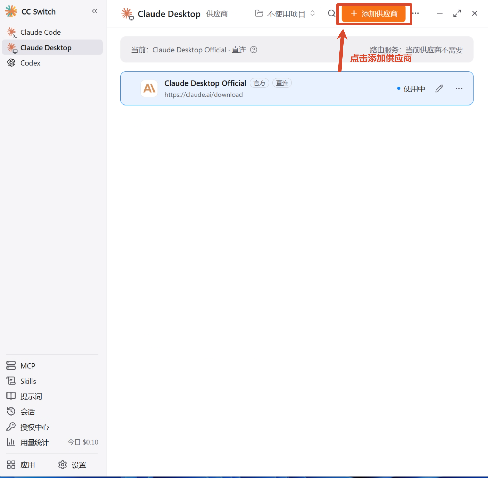
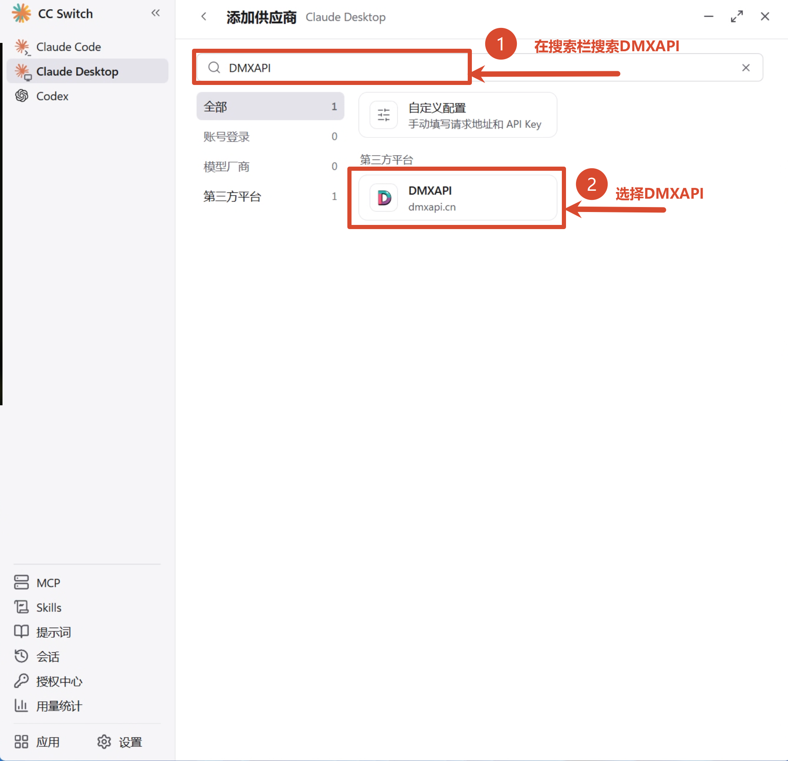
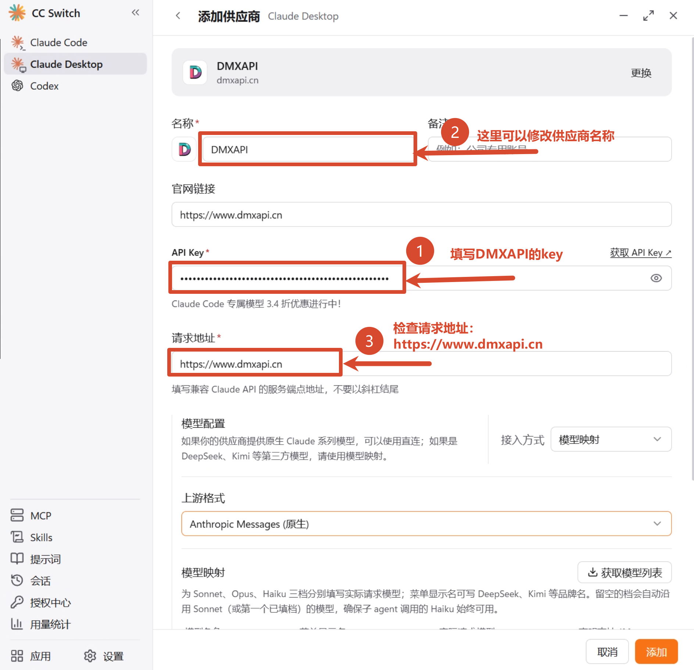
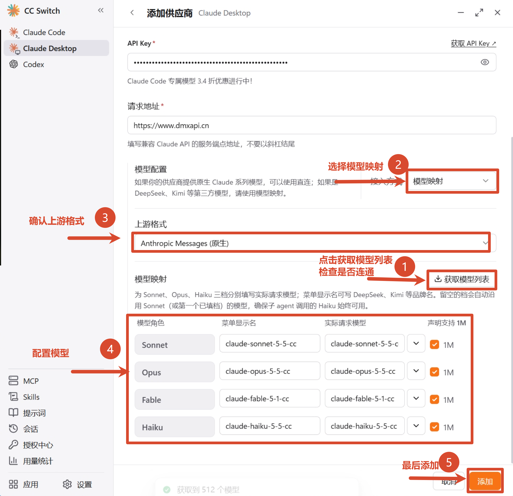
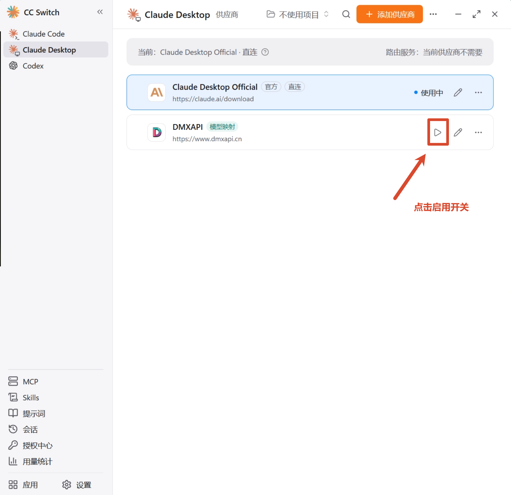
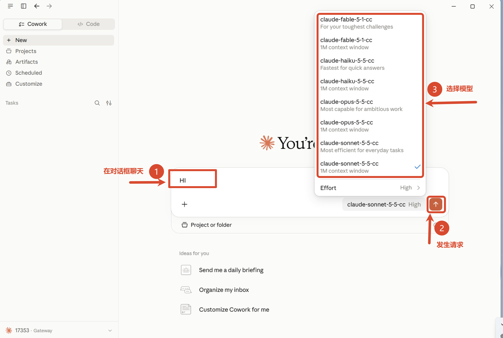
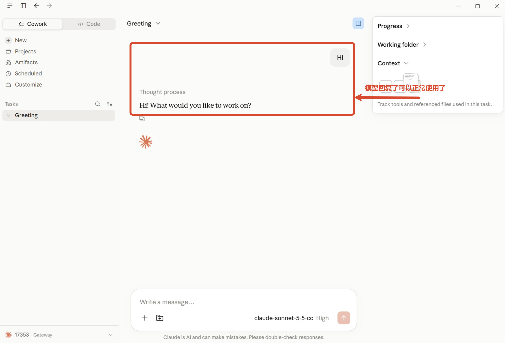

# CC Switch 配置 Claude Code 桌面端教程

CC-Switch 是一款面向开发者的多供应商配置切换工具，可在 Claude Code、Codex 等多种客户端之间一键切换不同的 API 厂商与模型。本文介绍如何使用 CC Switch 将 **Claude Code 桌面端（Claude Code Desktop）** 接入 DMXAPI。

## 环境准备

在开始之前，请先完成以下准备：

- 安装 **Claude Code 桌面端**：前往 [Claude 官网下载页](https://claude.com/download) 下载并安装。
- 下载 **CC Switch** 工具：前往 [CC Switch 官网](https://ccswitch.io/zh/) 下载。
- 准备一个 DMXAPI 令牌（API Key），可在 [DMXAPI 控制台](https://www.dmxapi.cn/keys) 的「API 令牌」页获取。

## 配置 Claude Code 桌面端

### 步骤 1：添加供应商

打开 CC Switch，按截图中的编号操作：

- ① 点击左侧的 **Claude Desktop** 选项卡
- ② 点击右上角橙色 **「添加供应商」** 按钮

### 步骤 2：选择预设供应商 DMXAPI

进入「添加新供应商」页面，按编号操作：

- ① 在搜索栏中搜索 **DMXAPI**
- ② 选择 **DMXAPI** 预设

### 步骤 3：填写 API Key 和请求地址

在配置表单中按编号填写：

- ① **API Key**：填写您的 DMXAPI 令牌
- ② **名称**：可自定义修改供应商名称
- ③ **请求地址**：检查是否为 `https://www.dmxapi.cn`

### 步骤 4：配置模型映射

继续在表单中向下操作：

- ① 点击 **「获取模型列表」** 检查是否连通
- ② 接入方式选择 **「模型映射」**
- ③ **上游格式**确认为 **Anthropic Messages（原生）**
- ④ 为 Sonnet / Opus / Fable / Haiku 各档位配置要使用的模型，如截图中的 `claude-sonnet-5-5-cc`、`claude-opus-5-5-cc`、`claude-fable-5-1-cc`、`claude-haiku-5-5-cc`
- ⑤ 确认无误后点击右下角的 **「添加」**

::: tip 提示
- **请求地址**填写兼容 Claude API 的服务端点地址，注意不要以斜杠结尾。
- Claude Code 只能使用模型广场 **Claude Code 专区**的模型。
:::

### 步骤 5：启用供应商

添加完成后，回到主界面：

- ① 在 DMXAPI 供应商卡片上点击 **「启用」** 开关

### 步骤 6：配置完成，开始使用

打开 Claude Code 桌面端：

- ① 在对话框中输入消息，如 `HI`
- ② 点击 **「发送」** 按钮发出请求
- ③ 点击输入框右下角的模型下拉框，选择刚配置好的模型，如 `claude-sonnet-5-5-cc`

### 步骤 7：验证模型响应

模型正常回复后，即可正常使用。恭喜你完成配置！

  <small>© 2026 DMXAPI CC Switch 配置 Claude Code 桌面端教程</small>

