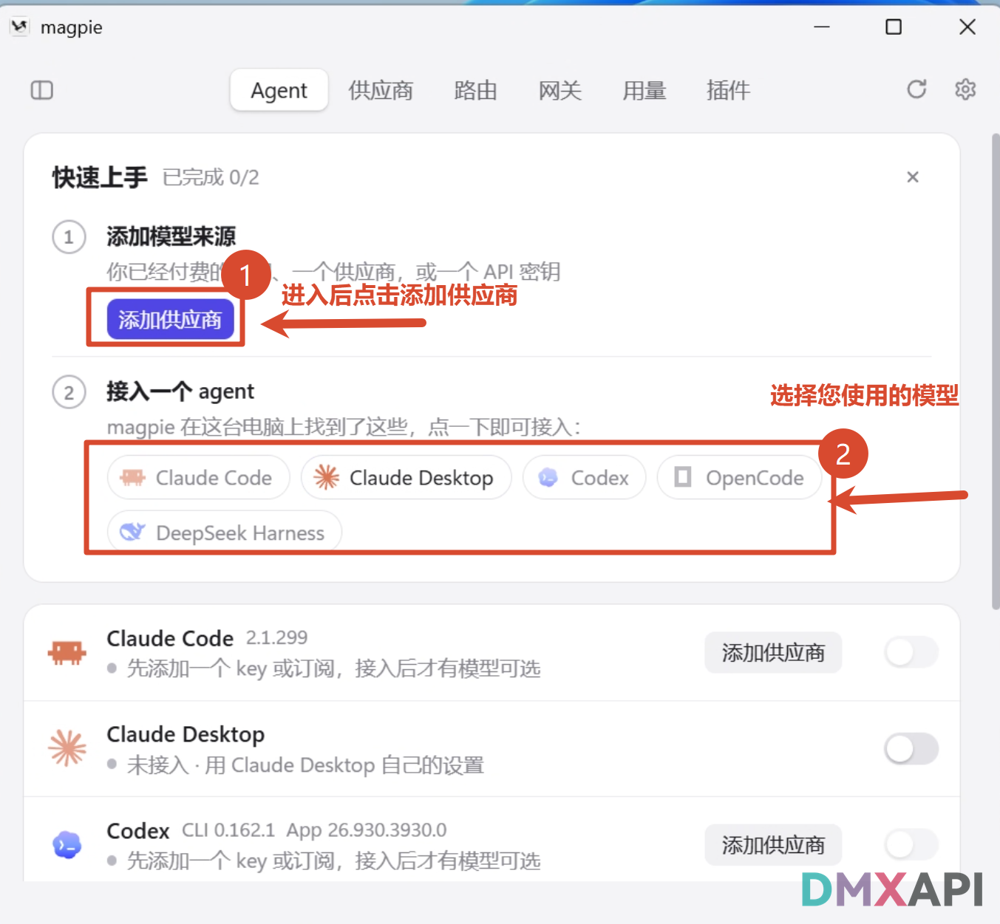
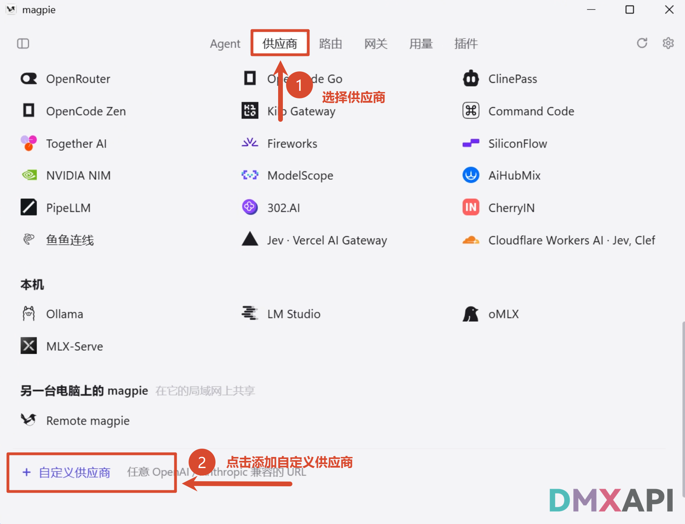
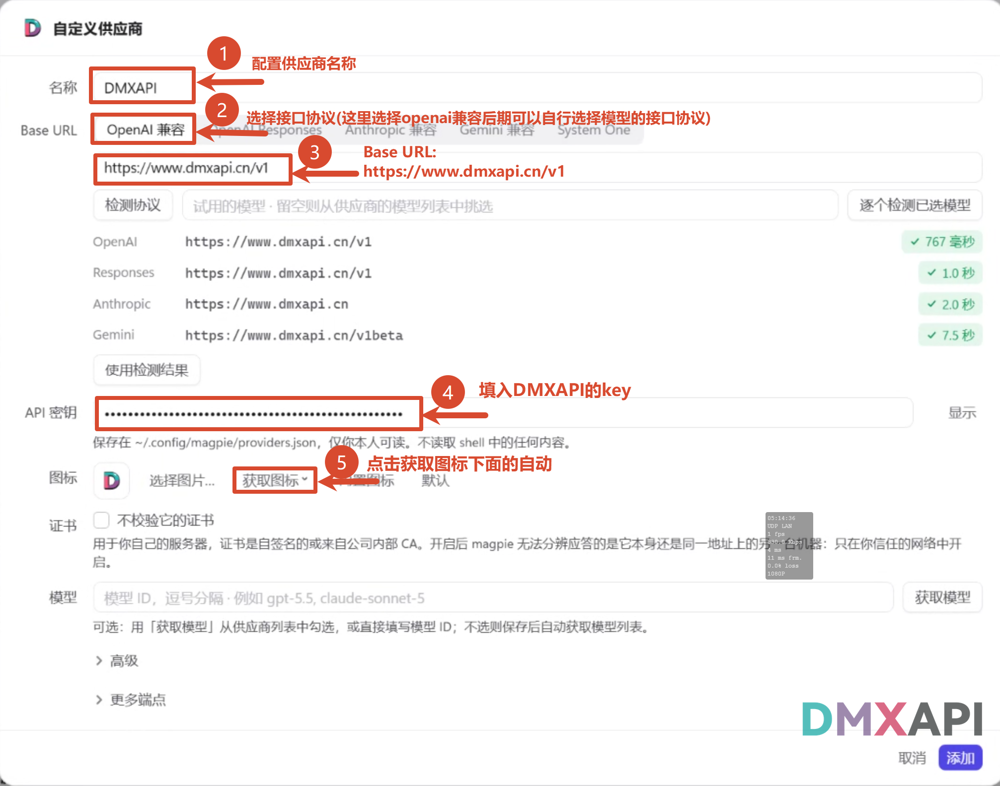
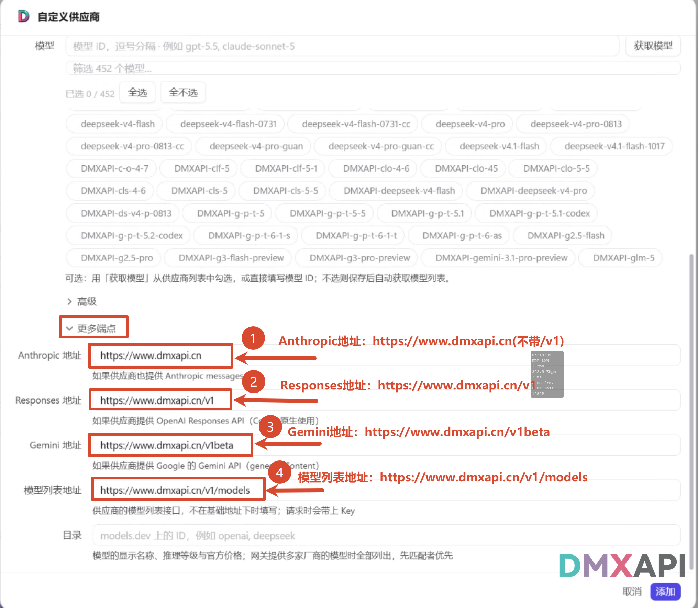
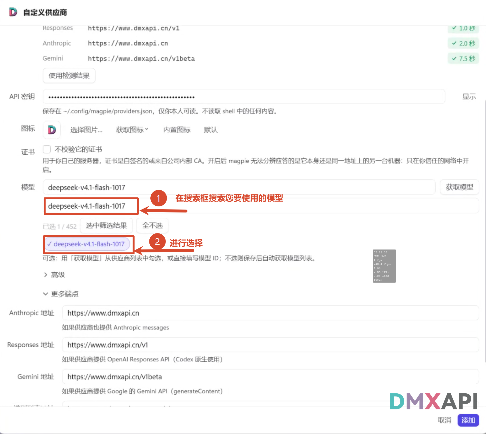
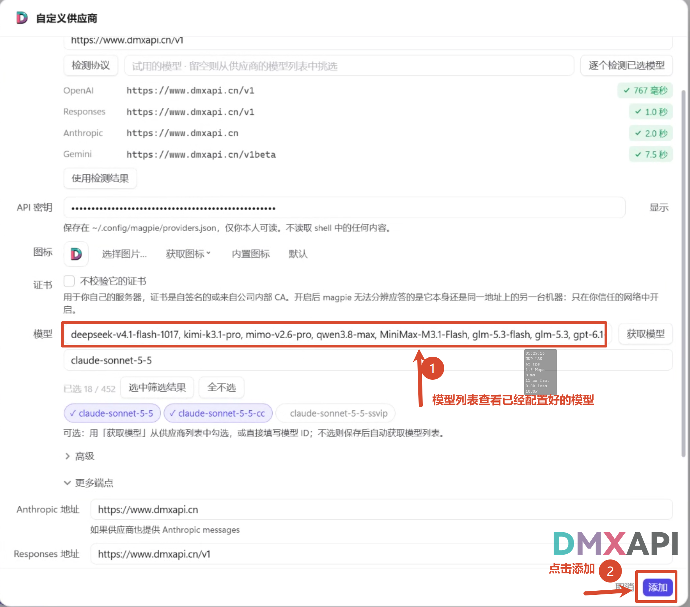
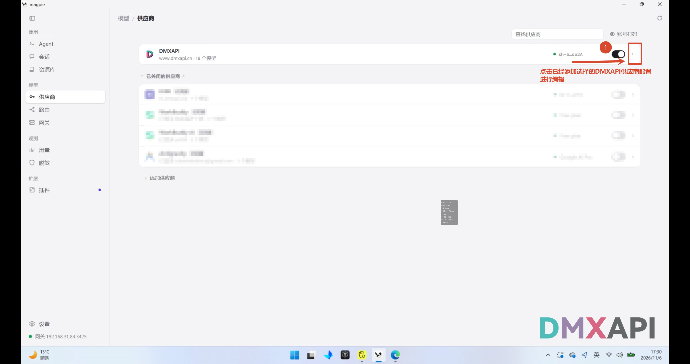
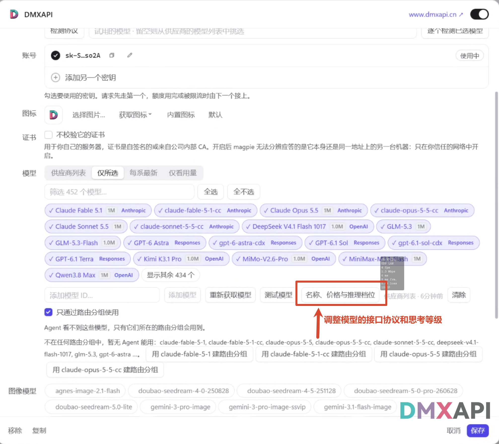
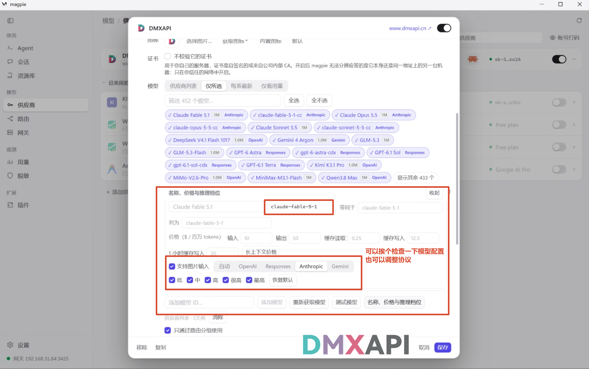
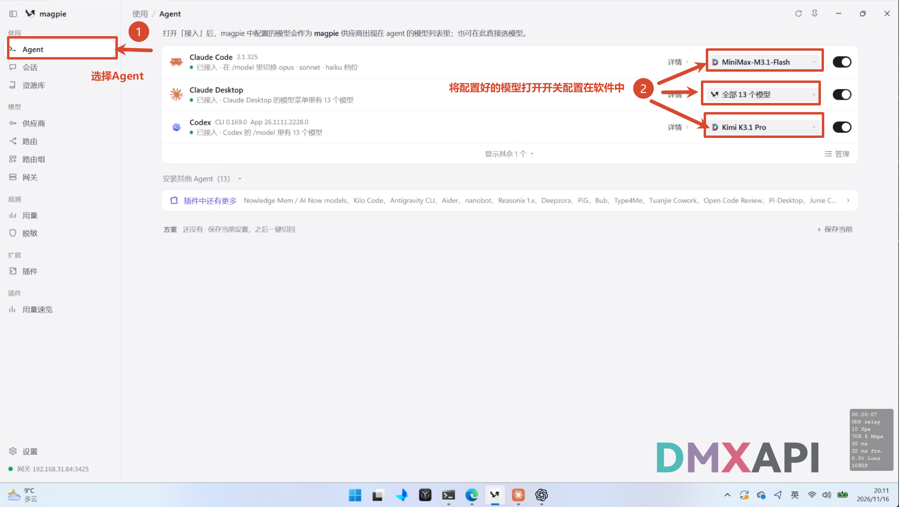

# Magpie 配置 DMXAPI 使用教程

Magpie 是一款免费、开源的本地 AI 模型网关与 Agent 模型管理工具，支持 macOS、Windows 和 Linux。它在您的电脑上运行一个本地网关（`127.0.0.1:3425`），同时支持 **OpenAI Chat Completions**、**OpenAI Responses**、**Anthropic Messages**、**Google Gemini** 四种 API 协议，并在它们之间双向转换（流式输出、工具调用、推理过程都会保留），因此任何 Agent 都能用上任何供应商的模型。
供应商只需在 Magpie 中添加一次，就可以在 Claude Code、Claude Desktop、Codex、Gemini CLI、OpenCode、DeepSeek Harness 等 Agent 中一键选用、随时切换，不必再到每个软件里分别填写接口地址和密钥。此外，Magpie 还提供隐私脱敏、智能路由与故障转移、按 Agent 统计用量等能力。
::: tip
编程类应用 tokens 消耗量较大，请留意 tokens 消耗。
:::
## 准备工作

在开始之前，请先完成以下准备：

- 前往 [Magpie 官网](https://usemagpie.ai/zh/) 下载并安装 Magpie 客户端，根据您的操作系统选择对应的安装包。
- 准备一个 DMXAPI 令牌（API Key），可在 [DMXAPI 控制台](https://www.dmxapi.cn/keys) 的「API 令牌」页获取。
- 在 [DMXAPI 模型广场](https://www.dmxapi.cn/rmb) 确认要使用的模型，复制完整的模型名称。
- 电脑上已安装需要接入的 Agent 软件（如 Claude Code、Claude Desktop、Codex 等），Magpie 会自动识别本机已安装的 Agent。

## 一、添加 DMXAPI 供应商

### 1. 点击「添加供应商」

首次打开 Magpie，「Agent」页面会显示「快速上手」引导：

1. 在「添加模型来源」下点击「添加供应商」
2. 「接入一个 agent」处会列出 Magpie 在本机找到的 Agent（如 Claude Code、Claude Desktop、Codex、OpenCode、DeepSeek Harness），供应商配置完成后，在这里选择您使用的软件即可接入（详见下文第三部分）

### 2. 选择「自定义供应商」

1. 点击顶部的「供应商」标签
2. 在供应商列表最下方，点击「+ 自定义供应商」（任意 OpenAI / Anthropic 兼容的 URL）

### 3. 填写供应商基本信息

在「自定义供应商」弹窗中依次填写：

1. **名称**：自定义供应商名称，例如 `DMXAPI`
2. **接口协议**：选择 `OpenAI 兼容`（这里先选 OpenAI 兼容即可，后续可以为每个模型单独选择接口协议）
3. **Base URL**：填入 `https://www.dmxapi.cn/v1`
4. **API 密钥**：填入您的 DMXAPI 密钥（密钥仅保存在本机的 `~/.config/magpie/providers.json` 中）
5. **图标**：点击「获取图标」，选择下方的「自动」，即可自动获取供应商图标

::: tip 检测协议
填好 Base URL 和 API 密钥后，可以点击「检测协议」：Magpie 会分别按 OpenAI（Chat Completions）、Responses、Anthropic、Gemini 四种协议各发送一个最小请求进行探测。四项都显示绿色对勾，说明各协议地址均连通正常。
:::

### 4. 填写「更多端点」

继续向下滚动，点击展开「更多端点」，依次填写 DMXAPI 各协议的地址：

1. **Anthropic 地址**：`https://www.dmxapi.cn`（根地址，**不带** `/v1`）
2. **Responses 地址**：`https://www.dmxapi.cn/v1`
3. **Gemini 地址**：`https://www.dmxapi.cn/v1beta`
4. **模型列表地址**：`https://www.dmxapi.cn/v1/models`

DMXAPI 同时支持以上几种协议，全部填写后，每个 Agent 会使用它原生支持的协议，其余由 Magpie 自动转换。

### 5. 搜索并选择模型

点击「模型」一栏右侧的「获取模型」，Magpie 会拉取 DMXAPI 的模型列表，然后：

1. 在筛选框中输入您要使用的模型名称，例如 `deepseek-v4.1-flash-1017`
2. 点击筛选结果中的模型进行选择，选中后模型前会出现 `✓`

重复以上操作，可以继续添加其他模型。

::: tip
- 也可以直接在「模型」输入框中填写模型 ID，多个模型之间用英文逗号分隔。
- DMXAPI 的模型数量较多，建议只选择常用的模型；如果一个都不选，保存后 Magpie 会自动获取完整的模型列表。
:::

### 6. 确认模型并添加

1. 在「模型」输入框中查看已经选好的模型，例如 `deepseek-v4.1-flash-1017`、`kimi-k3.1-pro`、`mimo-v2.6-pro`、`qwen3.8-max`、`MiniMax-M3.1-Flash`、`glm-5.3-flash`、`glm-5.3` 等
2. 确认无误后，点击右下角的「添加」，完成 DMXAPI 供应商的添加

## 二、调整模型的接口协议与思考等级

供应商添加完成后，建议逐个检查模型的接口协议与思考等级（推理档位），确保每个模型都按正确的协议调用。

### 1. 进入 DMXAPI 供应商配置

在「供应商」页面可以看到刚添加的 DMXAPI（显示域名与已选模型数量，如 `www.dmxapi.cn · 18 个模型`）。确认右侧开关处于打开状态，点击最右侧的 `>` 箭头进入编辑。

::: tip
截图中 Magpie 的导航有「顶部标签」和「左侧边栏」两种显示形式，各入口名称一致，按名称查找即可。
:::

### 2. 点击「名称、价格与推理档位」

在编辑弹窗的「模型」区域可以看到已选中的模型，以及每个模型当前使用的接口协议标签（如 `Anthropic`、`OpenAI`、`Responses`）。点击模型列表下方的「名称、价格与推理档位」，即可调整模型的接口协议和思考等级。

::: warning 注意
编辑页中的「只通过路由分组使用」勾选后，Agent 将看不到这些模型，只有它们所在的路由分组会用到。如果您没有配置路由分组，希望在 Agent 中直接选用 DMXAPI 的模型，请不要勾选此项。
:::

### 3. 逐个检查模型配置

展开后可以挨个检查每个模型的配置，并按需调整：

- **模型名称与 ID**：如 `Claude Fable 5.1` / `claude-fable-5-1`，请确认模型 ID 与 DMXAPI 的模型名称一致
- **支持图片输入**：模型支持图片输入时勾选
- **接口协议**：可选 `自动`、`OpenAI`、`Responses`、`Anthropic`、`Gemini`
- **思考等级（推理档位）**：`低`、`中`、`高`、`很高`、`最高`，勾选该模型支持的档位，点击「恢复默认」可还原

各系列模型推荐的接口协议如下：

| 模型系列 | 推荐接口协议 |
| --- | --- |
| Claude 系列（如 `claude-opus-5-5`、`claude-sonnet-5-5-cc`） | `Anthropic` |
| GPT 系列（如 `gpt-6-astra`、`gpt-6.1-sol`） | `Responses` |
| Gemini 系列 | `Gemini` |
| DeepSeek、Kimi、Qwen、MiMo、GLM、MiniMax 等其他模型 | `OpenAI`（或保持 `自动`） |

全部检查完成后，点击右下角的「保存」。

## 三、将配置好的模型接入 Agent

1. 在导航中选择「Agent」
2. 找到要使用的软件，打开右侧的开关完成接入，并在开关左侧的下拉框中选择配置好的模型（例如 Claude Code 选择 `MiniMax-M3.1-Flash`、Codex 选择 `Kimi K3.1 Pro`）

接入成功后，该软件下方会显示「已接入」，Magpie 中配置的模型会出现在它的模型列表里（如 Claude Code、Codex 的 `/model`，Claude Desktop 的模型菜单）。

::: tip 生效说明
- Agent 只在启动时读取配置，已经打开的会话仍使用原来的模型。接入或切换模型后，请**新开一个会话**；Codex 需要重启 Codex 应用并新开 `codex` 会话。
- Agent 的请求会经过 Magpie 的本地网关转发，使用期间请保持 Magpie 处于运行状态。
:::

  <small>© 2026 DMXAPI Magpie 配置教程</small>

