# Octop 配置 DMXAPI 使用教程

Octop 是一款支持多模型接入的 AI 桌面客户端，提供对话、专家、自动化、知识库等功能。通过自定义供应商接入 DMXAPI 后，即可在同一客户端中使用 DeepSeek、Kimi、Qwen、GLM、GPT、Claude 等模型。

**官方下载地址：** [https://octop.cloud/download](https://octop.cloud/download)

## 环境准备

在开始之前，请先完成以下准备：

- 下载并安装 **Octop 客户端**，根据您的操作系统选择对应安装包。
- 准备一个 DMXAPI 令牌（API Key），可在 [DMXAPI 控制台](https://www.dmxapi.cn/keys) 的「API 令牌」页获取。
- 在 DMXAPI 模型广场确认要使用的模型，复制完整的模型名称。

本文以 **Octop v1.0.3b2** 界面为例，分别演示三种对话接口的配置，以及可选的 Jev 决策模型配置。您可以按需配置其中一种接口，无需添加全部示例模型。

::: tip 配置前先确认接口格式
| 接口格式 | 供应商类型 | Base URL | 模型中的 API 模式 |
| --- | --- | --- | --- |
| Chat Completions | OpenAI 兼容 | `https://www.dmxapi.cn/v1` | Chat Completions（`/v1/chat/completions`） |
| Responses | OpenAI 兼容 | `https://www.dmxapi.cn/v1` | Responses（`/v1/responses`） |
| Anthropic Messages | Anthropic | `https://www.dmxapi.cn` | 使用 Anthropic 类型，无需选择 OpenAI API 模式 |

模型 ID 必须与模型广场中的名称完全一致。截图中的上下文窗口、最大输出 Token、输入类型和思考强度为示例配置，请以所选模型的实际规格为准。
:::

## 配置 Chat Completions 模型

本节以 DeepSeek 为例完成首次配置，再演示如何添加 Kimi、Qwen 和 GLM 模型。

### 步骤 1：添加自定义供应商

打开 Octop，按截图中的编号操作：

- ① 点击左侧的 **「模型配置」**
- ② 选择顶部的 **「对话模型」**
- ③ 在「自定义提供商」区域点击 **「+ 自定义供应商」**

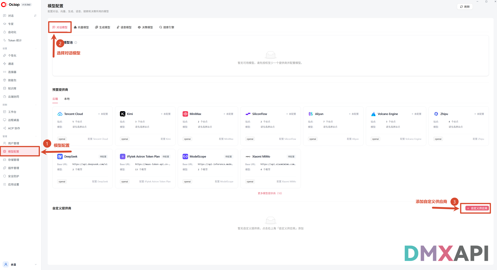

### 步骤 2：填写供应商信息

在「自定义供应商」页面中依次填写：

- ① **名称**：自定义一个便于识别的名称，例如 `DMXAPI-chat`
- ② **类型**：选择 **OpenAI 兼容**
- ③ **Base URL**：填入 `https://www.dmxapi.cn/v1`
- ④ **API Key**：填入您的 DMXAPI 令牌
- ⑤ 在「管理模型」区域点击 **「添加模型」**

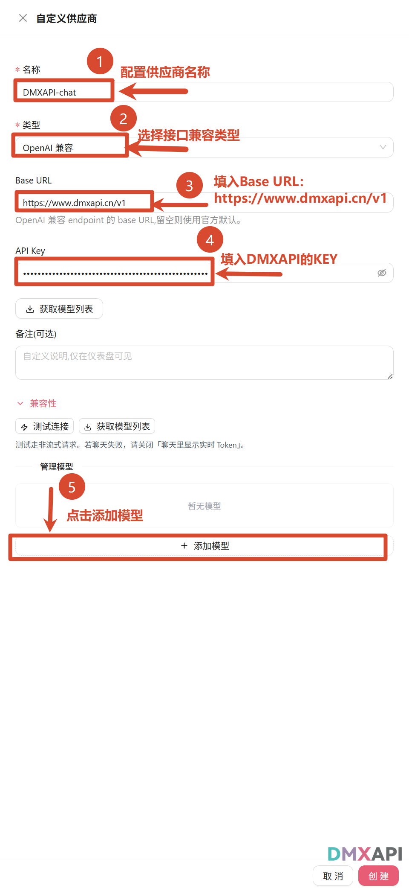

## 步骤 3：添加 DeepSeek 模型

以截图中的 `deepseek-v4.1-flash-1017` 为例，按编号配置：

- ① **模型 ID**：填入从模型广场复制的完整名称
- ② **模型名称**：设置在客户端中的显示名称，可以与模型 ID 相同
- ③ **OpenAI API 模式**：选择 **Chat Completions（/v1/chat/completions）**
- ④ **支持的输入类型**：根据模型能力选择，截图示例为 **文本、图像**
- ⑤ **上下文窗口 / 最大输出 Token**：根据模型规格填写，截图示例为 `1000000` / `128000`
- ⑥ 展开模型能力，按需开启 **「支持推理」**，设置是否允许在对话里关闭思考以及默认思考状态
- ⑦ **支持的思考强度**：按模型支持的档位配置，截图示例为 `low`、`high`、`max`，默认强度为 `max`
- ⑧ **推理协议**：选择 **DeepSeek / GLM / Kimi**
- ⑨ 点击 **「添加模型」**

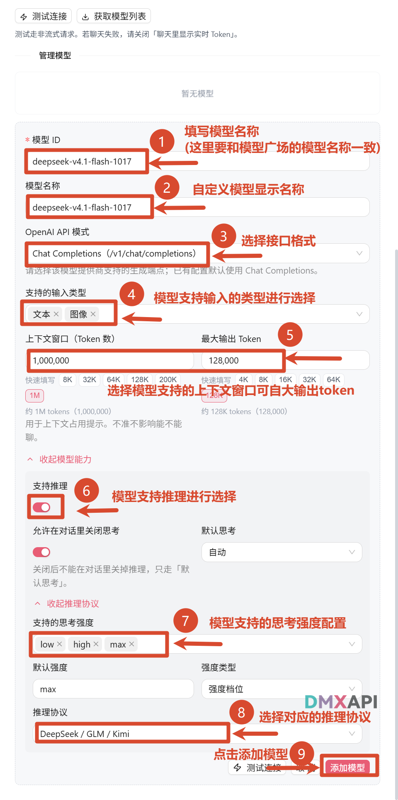

### 步骤 4：创建供应商

添加模型后，回到供应商表单：

- ① 确认模型已出现在「管理模型」列表中，且左侧开关已开启
- ② 点击右下角的 **「创建」**，保存供应商配置

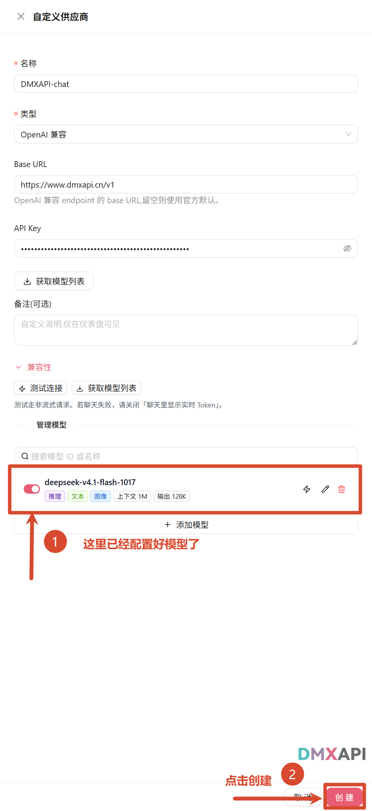

## 步骤 5：添加 Kimi 模型（可选）

如需继续添加模型，回到「模型配置 → 对话模型」，点击 `DMXAPI-chat` 供应商卡片上的编辑图标，再点击 **「添加模型」**。

以 `kimi-k3.1-pro` 为例：

- ①② **模型 ID / 模型名称**：填写 `kimi-k3.1-pro`，显示名称可自定义
- ③ **OpenAI API 模式**：选择 **Chat Completions（/v1/chat/completions）**
- ④⑤ 根据模型规格配置 **支持的输入类型、上下文窗口、最大输出 Token**
- ⑥ 开启 **「支持推理」**，按需设置默认思考状态
- ⑦ **支持的思考强度**：截图示例为 `low`、`high`、`max`
- ⑧ **推理协议**：选择 **DeepSeek / GLM / Kimi**
- ⑨ 点击 **「添加模型」**

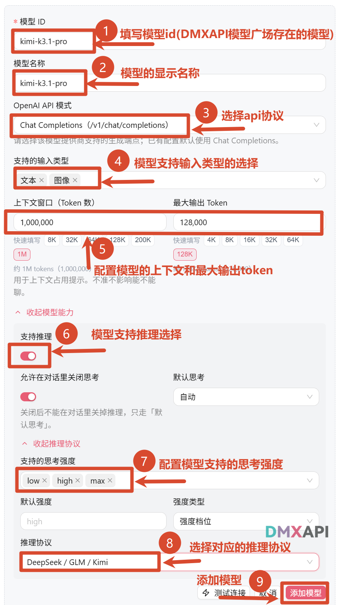

## 步骤 6：添加 Qwen 模型（可选）

继续点击 **「添加模型」**，以 `qwen3.8-max` 为例：

- ①② **模型 ID / 模型名称**：填写 `qwen3.8-max`，显示名称可自定义
- ③ **OpenAI API 模式**：选择 **Chat Completions（/v1/chat/completions）**
- ④⑤ 根据模型规格配置 **支持的输入类型、上下文窗口、最大输出 Token**
- ⑥ 开启 **「支持推理」**
- ⑦ **支持的思考强度**：截图示例为 `low`、`medium`、`xhigh`
- ⑧ **推理协议**：选择 **DashScope / 阿里云**
- ⑨ 点击 **「添加模型」**

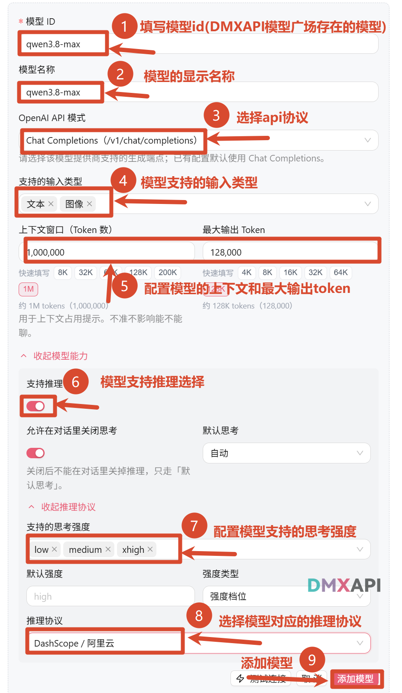

## 步骤 7：添加 GLM 模型（可选）

以 `glm-5.3` 为例：

- ①② **模型 ID / 模型名称**：填写 `glm-5.3`，显示名称可自定义
- ③ **OpenAI API 模式**：选择 **Chat Completions（/v1/chat/completions）**
- ④ **支持的输入类型**：截图示例选择 **文本**
- ⑤ 根据模型规格配置 **上下文窗口、最大输出 Token**
- ⑥ 开启 **「支持推理」**
- ⑦ 本示例关闭 **「允许在对话里关闭思考」**，默认思考选择 **开启**
- ⑧ **支持的思考强度**：截图示例为 `low`、`high`、`max`
- ⑨ **推理协议**：选择 **DeepSeek / GLM / Kimi**
- ⑩ 点击 **「添加模型」**

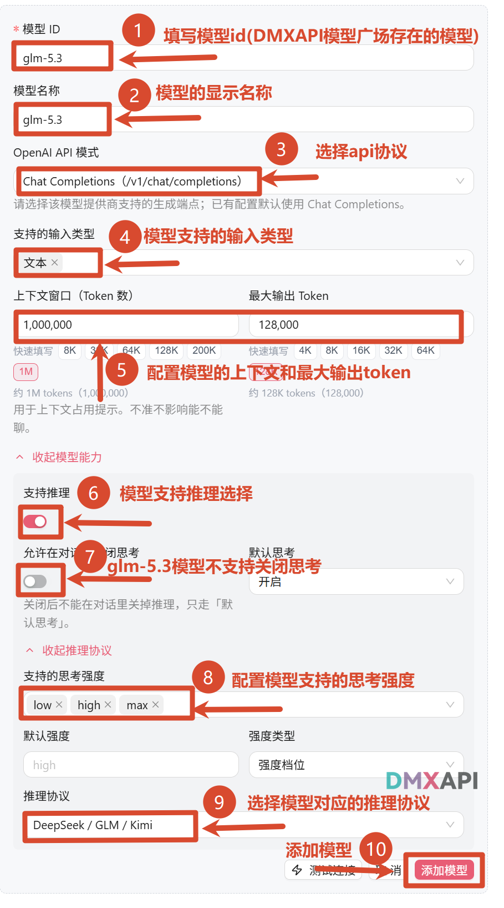

添加 `glm-5.3-flash` 时，操作步骤相同，将模型 ID 改为 `glm-5.3-flash`，并按该模型的实际能力选择输入类型。截图示例选择 **文本、图像**，关闭 **「允许在对话里关闭思考」**，推理协议仍为 **DeepSeek / GLM / Kimi**。

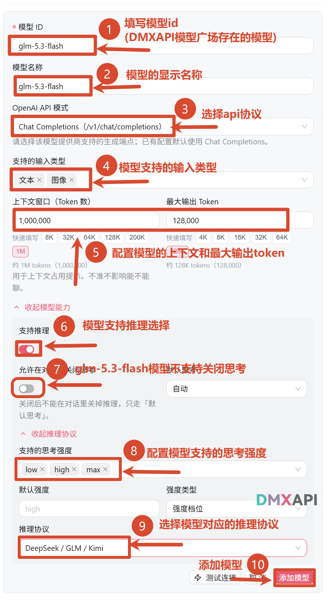

### 步骤 8：检查模型列表并保存

完成所需模型的添加后：

- 确认模型列表中的名称正确，所需模型的开关均已开启
- 可在 **「默认模型」** 中选择用于测试连接的模型，例如 `deepseek-v4.1-flash-1017`
- 点击右下角的 **「保存」**

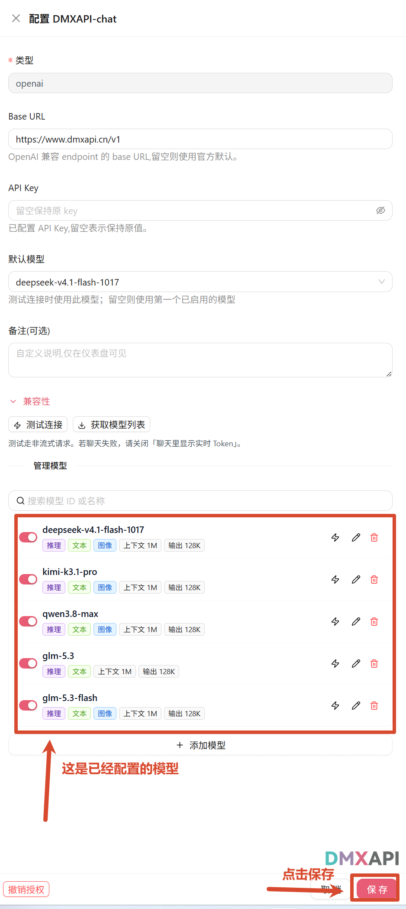

## 配置 Responses 模型

本节演示使用 OpenAI Responses 格式接入 GPT 模型。

### 步骤 1：添加 Responses 供应商

回到「模型配置 → 对话模型」，点击 **「+ 自定义供应商」**：

- ① **名称**：例如 `DMXAPI-response`，便于与 Chat Completions 配置区分
- ② **类型**：选择 **OpenAI 兼容**
- ③ **Base URL**：填入 `https://www.dmxapi.cn/v1`
- ④ **API Key**：填入您的 DMXAPI 令牌
- ⑤ 点击 **「添加模型」**

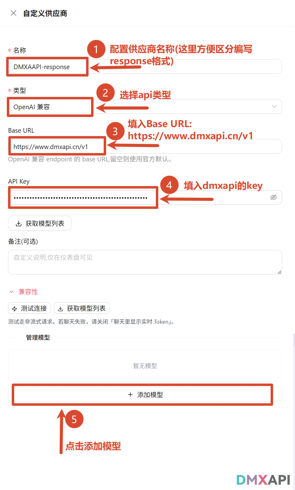

## 步骤 2：添加 GPT 模型

以 `gpt-6.1-sol` 为例，按截图中的编号配置：

- ①② **模型 ID / 模型名称**：填写 `gpt-6.1-sol`，显示名称可自定义
- ③ **OpenAI API 模式**：选择 **Responses（/v1/responses）**
- ④ **协议回退**：选择 **不回退（推荐）**
- ⑤⑥ 根据模型规格配置 **支持的输入类型、上下文窗口、最大输出 Token**
- ⑦ 开启 **「支持推理」**
- ⑧ 本示例关闭 **「允许在对话里关闭思考」**，默认思考选择 **开启**
- ⑨ **支持的思考强度**：截图示例为 `low`、`medium`、`high`、`xhigh`、`max`
- ⑩ **推理协议**：选择 **OpenAI / Gemini / Groq**
- ⑪ 点击 **「添加模型」**

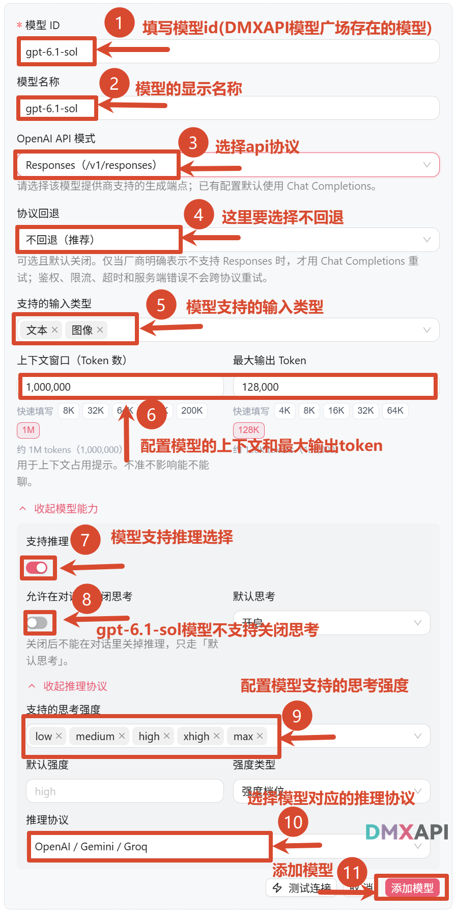

::: tip 提示
Responses 与 Chat Completions 的供应商类型和 Base URL 相同，区别在模型设置中的 **「OpenAI API 模式」**。请根据所选模型支持的接口选择模式，Base URL 无需再拼接 `/responses`。
:::

### 步骤 3：添加其他 GPT 模型（可选）

如需使用其他 GPT 模型，可继续点击 **「添加模型」**，分别填写对应的模型 ID。以下示例均使用 **Responses（/v1/responses）**，协议回退选择 **不回退（推荐）**，推理协议选择 **OpenAI / Gemini / Groq**。

**GPT 6.1 Terra：** 模型 ID 填写 `gpt-6.1-terra`，其余选项按该模型规格配置，完成后点击 **「添加模型」**。

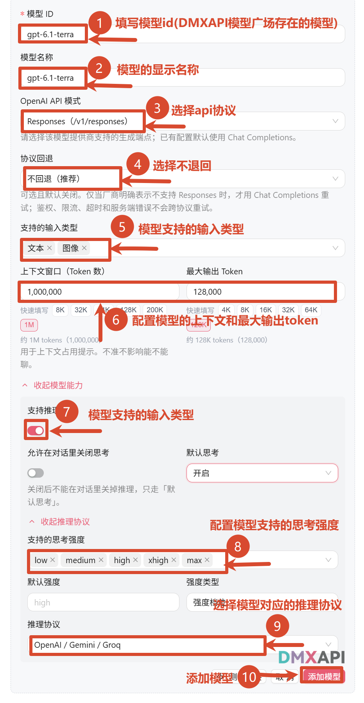

**GPT 6 Astra：** 模型 ID 填写 `gpt-6-astra`，配置输入类型、模型限制和思考强度后，点击 **「添加模型」**。

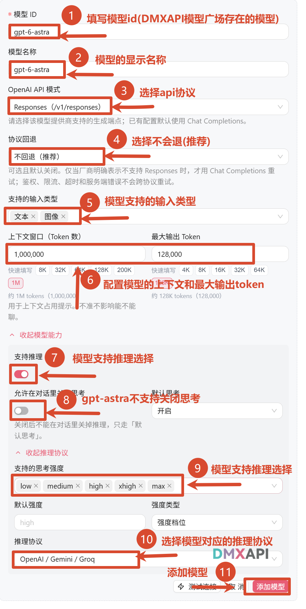

**GPT 6 Luna：** 模型 ID 填写 `gpt-6-luna`，配置完成后点击 **「添加模型」**。

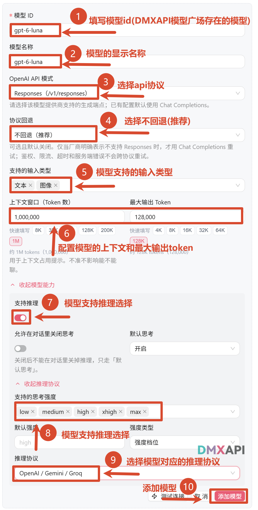

### 步骤 4：保存 Responses 配置

首次添加供应商时，点击表单底部的 **「创建」**。如果是在已有供应商中编辑，检查模型列表并点击 **「保存」**：

- ① 确认所需模型已添加并启用
- ② 点击右下角的 **「保存」**

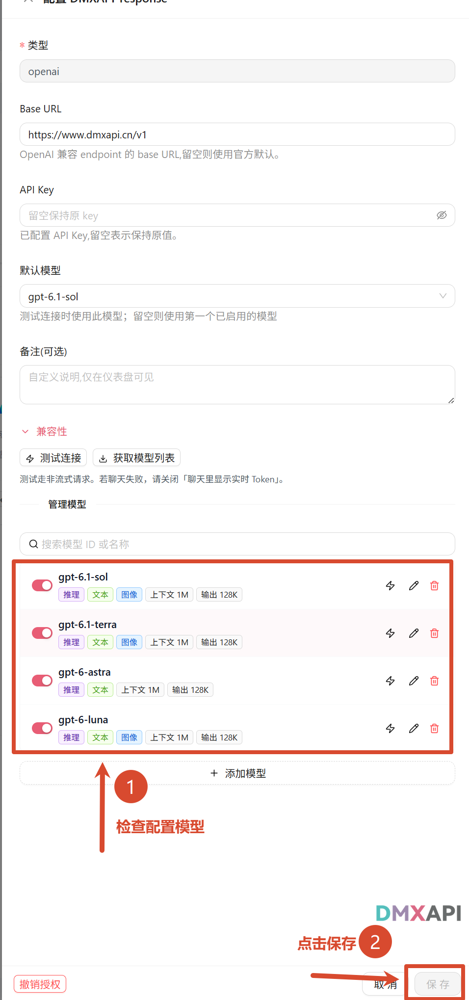

## 配置 Anthropic 模型

本节演示通过 Anthropic Messages 格式接入 Claude 模型。

### 步骤 1：添加 Anthropic 供应商

回到「模型配置 → 对话模型」，点击 **「+ 自定义供应商」**：

- ① **名称**：例如 `DMXAPI-message`
- ② **类型**：选择 **Anthropic**
- ③ **Base URL**：填入 `https://www.dmxapi.cn`
- ④ **API Key**：填入您的 DMXAPI 令牌
- ⑤ 点击 **「添加模型」**

::: tip 提示
此处 Anthropic 类型的 Base URL 填写到 `.cn` 即可，不添加 `/v1`，也不以斜杠结尾。
:::

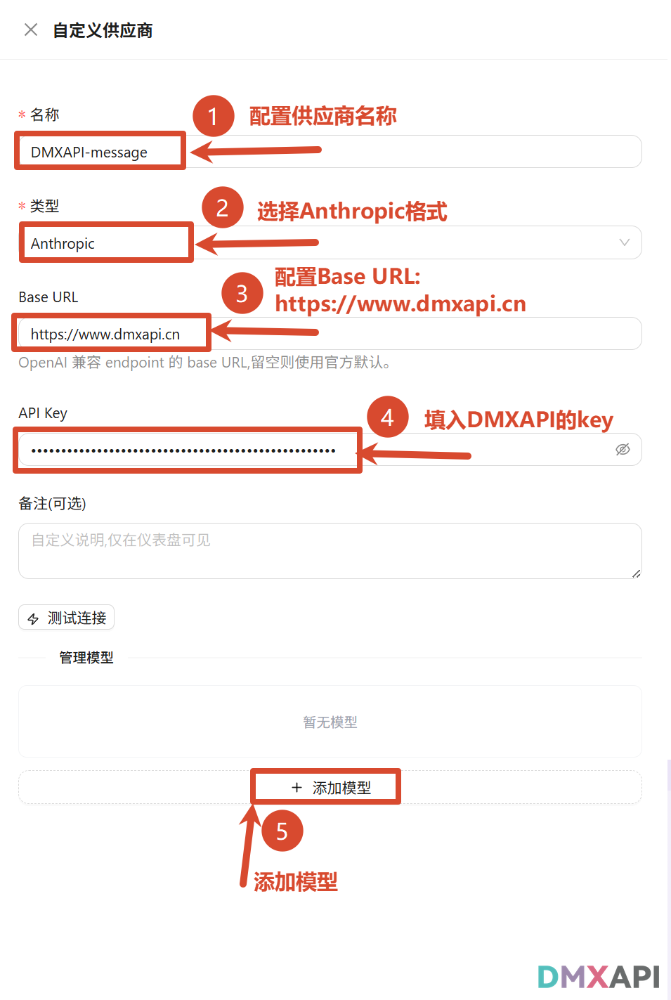

## 步骤 2：添加 Claude Opus 模型

以 `claude-opus-5-5` 为例，按编号配置：

- ①② **模型 ID / 模型名称**：填写 `claude-opus-5-5`，显示名称可自定义
- ③ **支持的输入类型**：根据模型能力选择，截图示例为 **文本、图像**
- ④ 根据模型规格配置 **上下文窗口、最大输出 Token**
- ⑤ 开启 **「支持推理」**；截图示例关闭「允许在对话里关闭思考」，默认思考为 **自动**
- ⑥ **支持的思考强度**：截图示例为 `low`、`medium`、`high`、`xhigh`、`max`
- ⑦ **推理协议**：选择 **Anthropic Adaptive**
- ⑧ 点击 **「添加模型」**

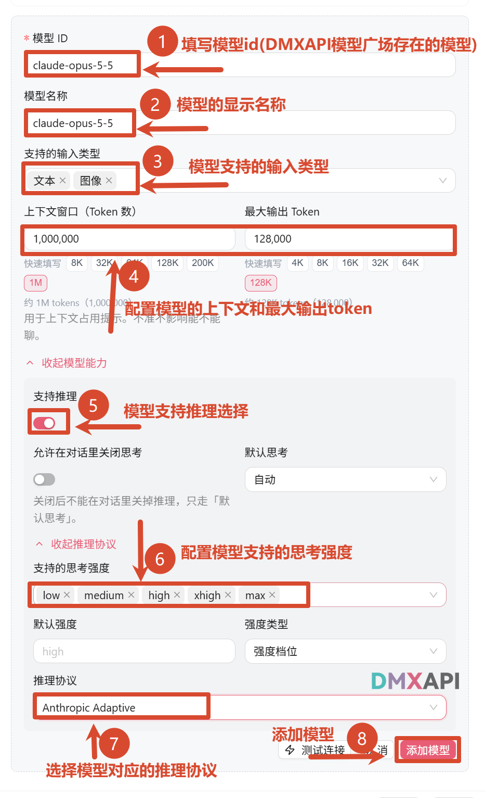

### 步骤 3：添加其他 Claude 模型（可选）

以下模型的添加方式与上一步相同。填写对应的模型 ID，按模型能力配置输入类型、上下文窗口和最大输出 Token；截图中的推理协议均为 **Anthropic Adaptive**。

**Claude Sonnet：** 模型 ID 填写 `claude-sonnet-5-5`，配置完成后点击 **「添加模型」**。

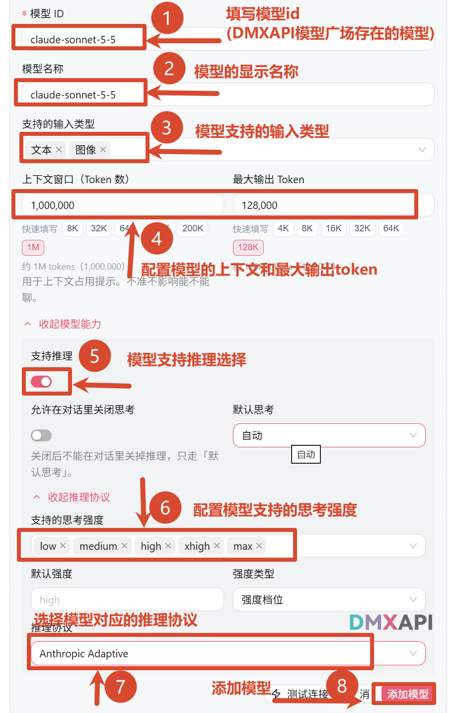

**Claude Haiku：** 模型 ID 填写 `claude-haiku-5-5`，配置完成后点击 **「添加模型」**。

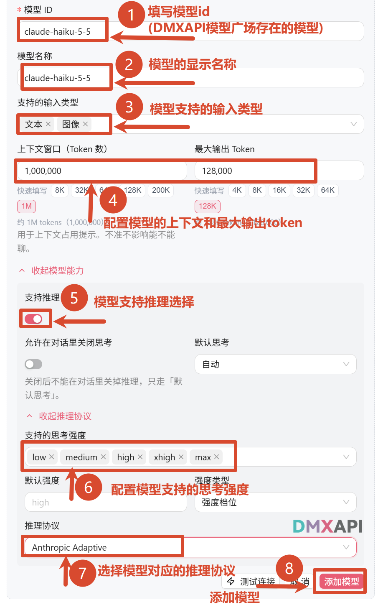

**Claude Fable：** 模型 ID 填写 `claude-fable-5-1`，配置完成后点击 **「添加模型」**。

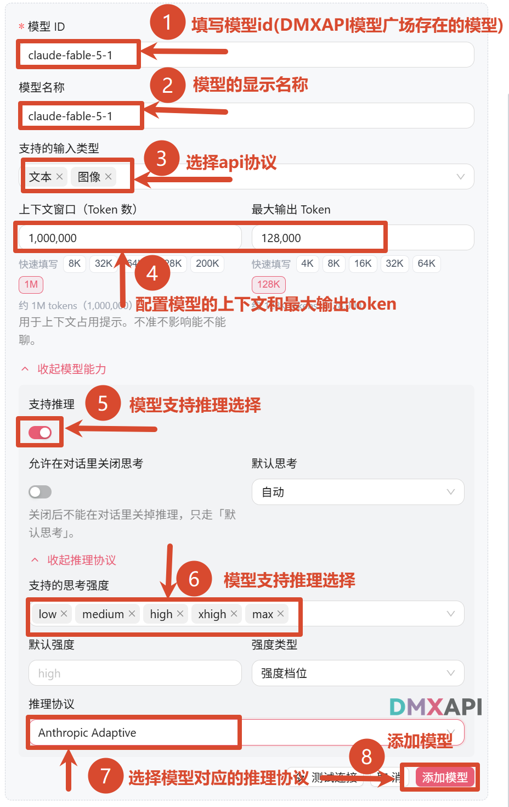

### 步骤 4：保存 Anthropic 配置

首次添加供应商时，点击表单底部的 **「创建」**。如果是在已有供应商中编辑：

- ① 检查模型列表，确认所需模型已添加并启用
- ② 点击右下角的 **「保存」**

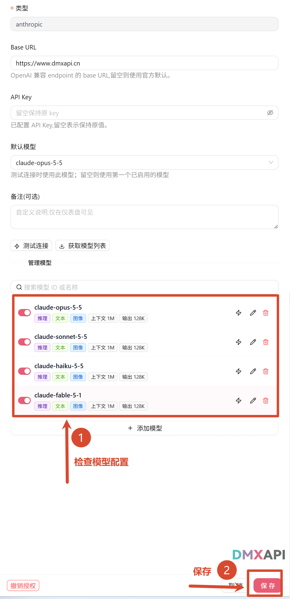

## 检查供应商状态

回到「模型配置 → 对话模型」页面，在「自定义提供商」区域检查已添加的供应商：

- 供应商卡片处于 **「已启用」** 状态
- Base URL 与所选接口格式对应
- 模型数量与您实际添加的数量一致，所需模型已出现在上方模型池中

如需检查连接，可点击卡片上的闪电图标或进入配置表单点击 **「测试连接」**。截图展示了三种供应商均已配置的状态，您只需保留自己需要使用的配置。

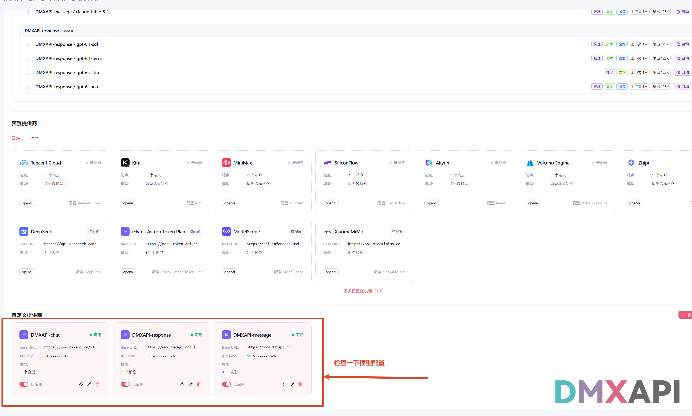

## 配置 Jev 决策模型（可选）

决策模型用于在对话模型回答前，筛选本轮适用的技能、工具或团队成员。仅使用普通对话时，可以跳过本节。

### 步骤 1：打开决策模型设置

按截图中的编号操作：

- ① 点击左侧的 **「模型配置」**
- ② 选择顶部的 **「决策模型」**
- ③ 打开 **「启用决策模型」** 开关
- ④ 选择 **Jev**，点击卡片上的 **「编辑」**

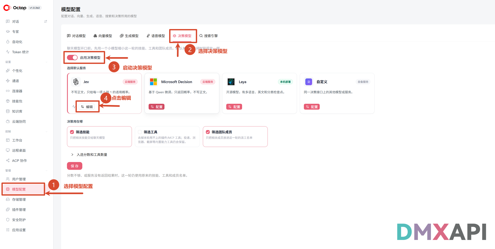

### 步骤 2：填写 Jev 连接配置

在 Jev 配置页面中填写：

- ① **服务地址**：`https://www.dmxapi.cn/typesafe/v1/systemone`
- ② **模型**：`jev-latest`
- ③ **API Key**：填入您的 DMXAPI 令牌

填写完成后，先点击底部的 **「测试连接」**，连接正常后再点击 **「保存」**。

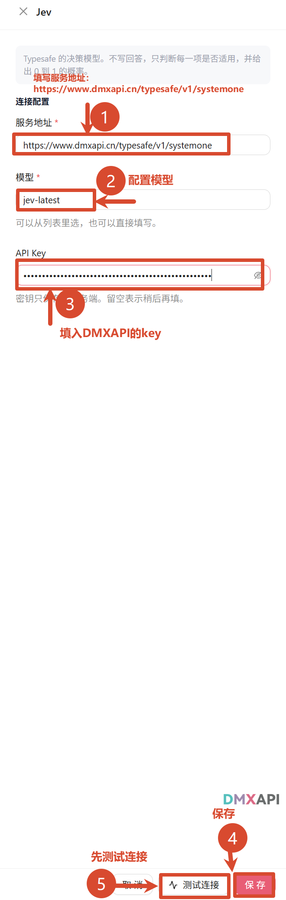

返回「决策模型」页面后，在 **「决策用在哪」** 区域按需选择「筛选技能」「筛选工具」「筛选团队成员」，再点击页面中的 **「保存」**。截图示例选择了「筛选技能」和「筛选团队成员」。

## 对话测试

### 步骤 1：打开模型选择菜单

进入左侧的 **「对话」** 页面，在输入框左下角：

- ① 点击 **「+」** 按钮
- ② 选择 **「模型」**

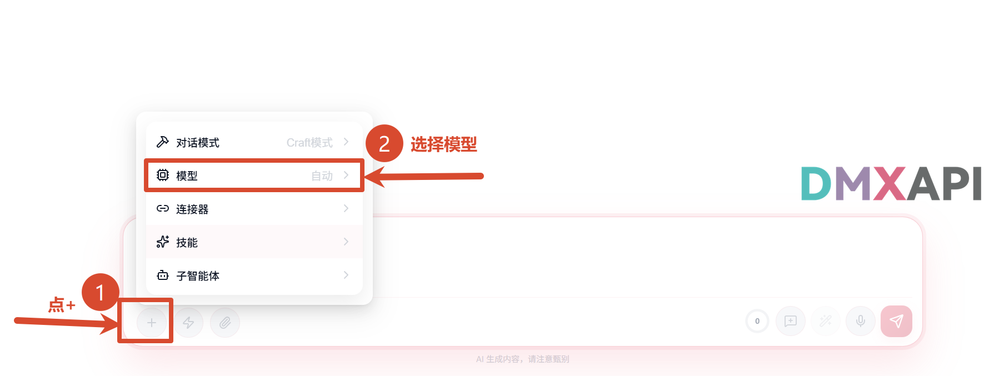

### 步骤 2：选择已配置的模型

在模型列表中选择您刚添加的模型，例如 **DMXAPI-chat / deepseek-v4.1-flash-1017**。也可以在搜索框中输入模型名称查找。

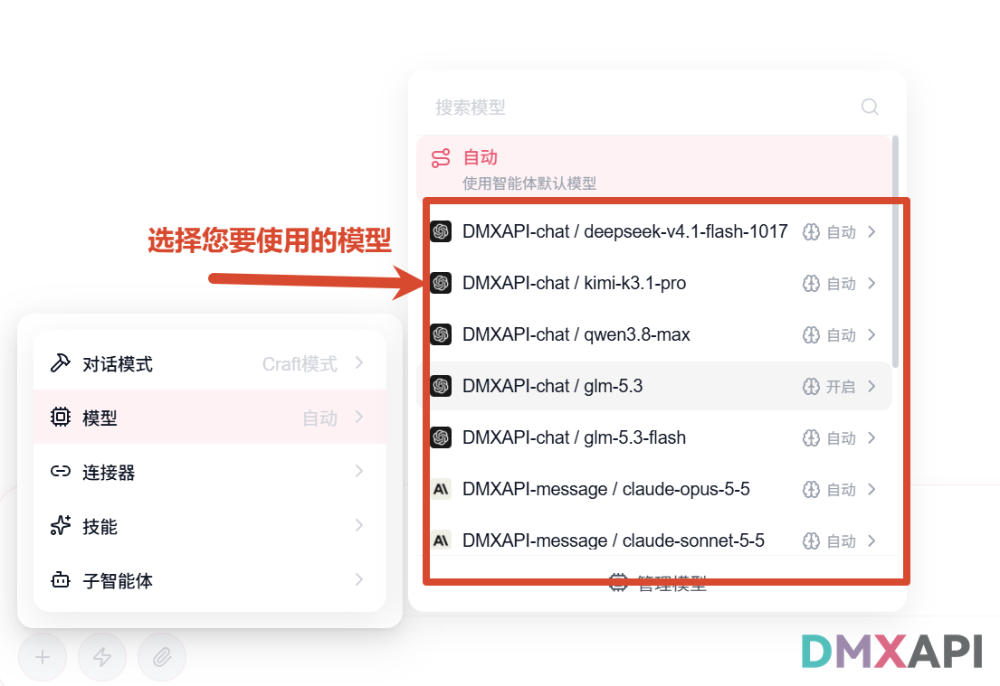

### 步骤 3：发送测试消息

在输入框中输入 `你好` 或 `hi`，点击右下角的发送按钮。

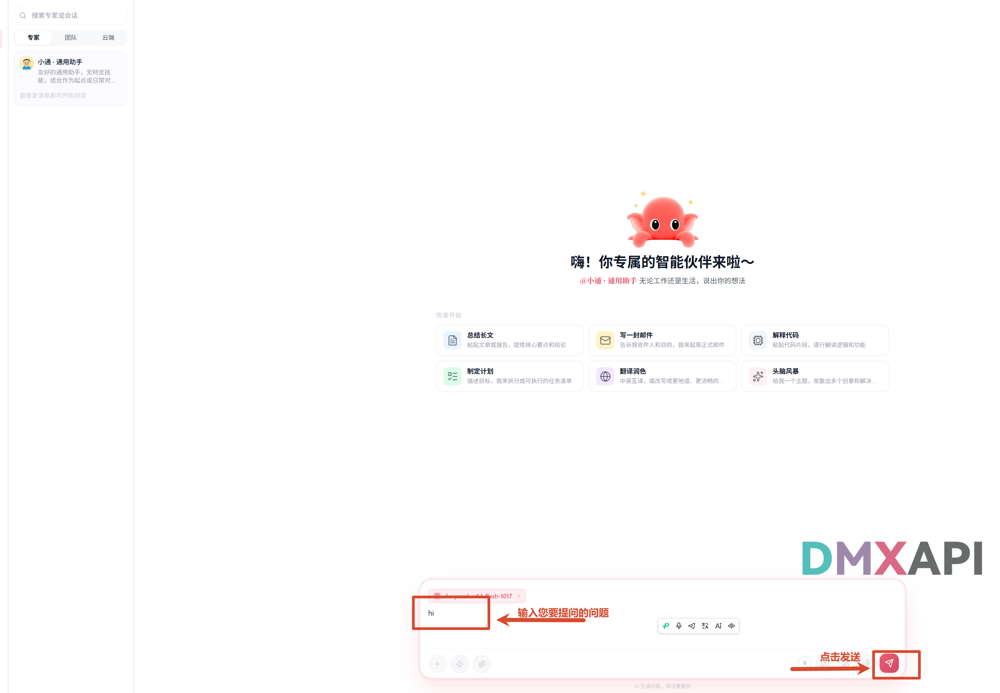

### 步骤 4：确认模型正常回复

收到模型回复后，即可开始使用。若已启用 Jev 决策模型，对话中还可能显示 **「决策模型 jev-latest 已介入」** 的提示。

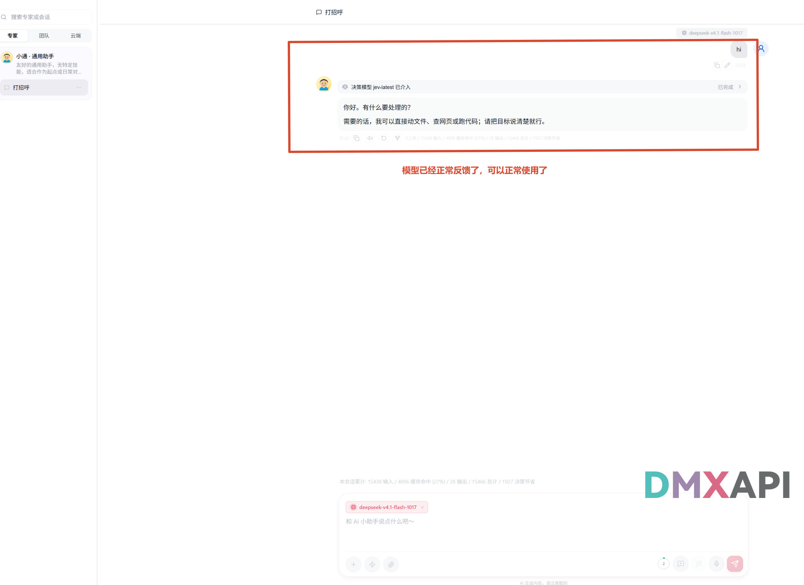

## 常见问题

### 1. 模型没有出现在对话列表中

检查供应商和模型的开关是否均已开启，添加模型后是否点击了供应商表单底部的 **「创建」** 或 **「保存」**，再重新打开对话中的模型菜单。

### 2. 请求地址或接口格式不匹配

OpenAI 兼容类型填写 `https://www.dmxapi.cn/v1`，并在模型中选择正确的 Chat Completions 或 Responses 模式；Anthropic 类型填写 `https://www.dmxapi.cn`。Jev 使用本节给出的完整 TypeSafe 服务地址。

### 3. 提示模型不存在或没有权限

核对模型 ID 是否与 DMXAPI 模型广场中的名称完全一致，并确认当前 API Key 可以使用该模型。修改显示名称不会改变实际请求使用的模型 ID。

  <small>© 2026 DMXAPI Octop 配置教程</small>

