# Reasonix Studio 配置 DMXAPI 使用教程

Reasonix Studio 是一款本地优先的 AI Agent 编程工作台（桌面客户端），提供对话、运行分析、工作台等能力，支持 MCP · Skills 工具集成与 Local / SSH 运行环境，可通过自定义模型服务接入 **OpenAI 兼容**、**OpenAI Responses**、**Anthropic 兼容** 的 API 服务。
接入 DMXAPI 后，即可在 Reasonix Studio 中使用 DeepSeek、Kimi、GLM、GPT、Claude 等主流模型。

## 1. 首次启动 {#first-start}

首次启动 Reasonix Studio 会进入「开始设置」向导，依次完成「连接模型服务」与「选择默认模型」后即可进入主界面。

### 连接模型服务

在向导第一步「连接模型服务」中依次填写：

1. **服务地址**：填入 `https://www.dmxapi.cn/v1`
2. **API key**：填入您的 DMXAPI 密钥（可在 DMXAPI 网站「工作台 → API 令牌」处获取）

填写完成后点击「连接并继续」。key 仅保存在本机配置中，不会上传至任何第三方。

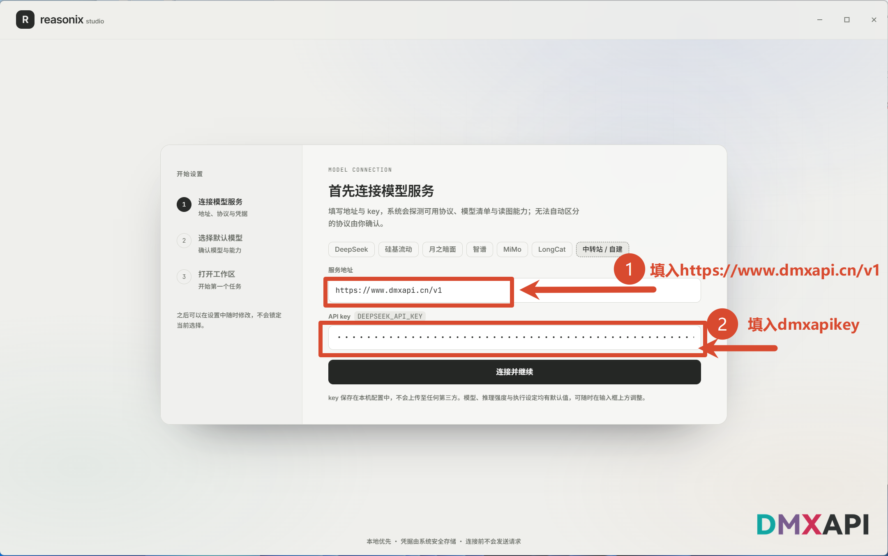

### 选择接口格式与默认模型

连接成功后，系统会显示已连上的模型数量。在第二步「选择默认模型」中：

1. **接口格式**：选择「OpenAI 兼容（Chat Completions）」
2. **模型**：配置您要使用的模型，例如 `deepseek-v4.1-flash` （模型 ID 可在 DMXAPI 网站顶部「模型价格」页面查看并复制）
3. 点击「开始」进入主界面

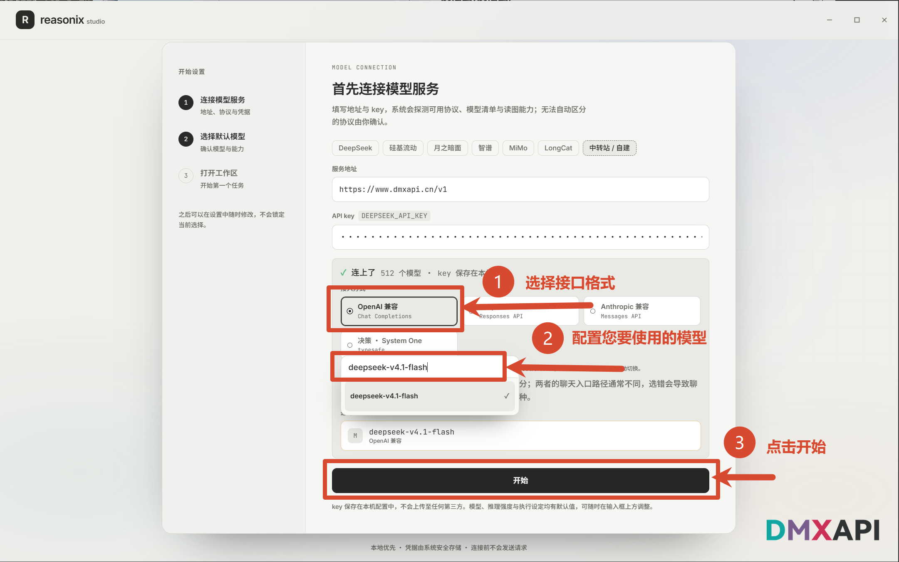

## 2. 基础配置 {#basic-config}

进入主界面后
 如需添加更多模型服务，点击左下角的「设置」图标进入设置页面。底部输入框右侧可看到当前使用的模型。

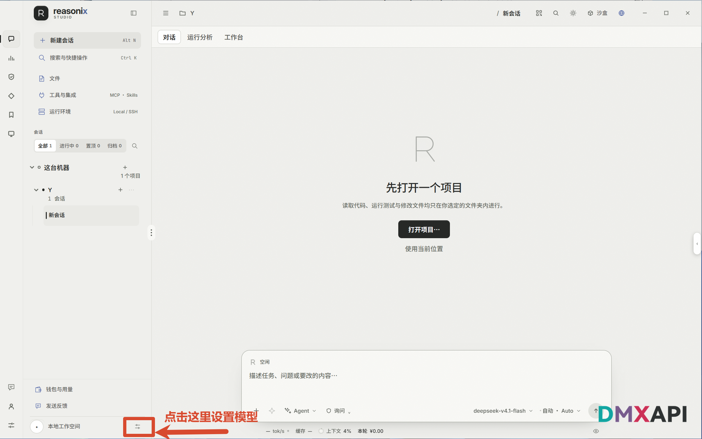

### 添加模型服务

在设置左侧菜单中选择「模型服务」，点击「+ 添加模型服务」，在弹窗中依次填写：

1. **来源名称**：自定义供应商名称，例如 `DMXAPI-chat` （名称只能用字母、数字、点、连字符和下划线，以字母或数字开头，最长 64 个字符）
2. **接口协议**：选择 `OpenAI 兼容`
3. **接口地址**：填入 `https://www.dmxapi.cn/v1`
4. **API Key**：填入您的 DMXAPI 密钥

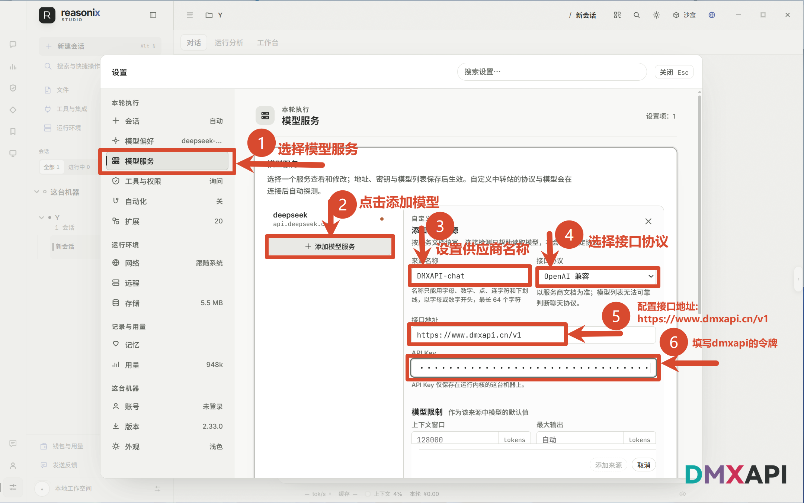

### 配置模型限制与思考协议

继续向下滚动：

1. **模型限制**：按模型文档填写「上下文窗口」和「最大输出」，例如 `1000000` 和 `384000` tokens（作为该来源中模型的默认值）
2. **高级连接选项 → 思考协议**：选择 `DeepSeek`（使用「自动」时由模型和接口协议决定，只有中转站文档明确要求时才手动指定）

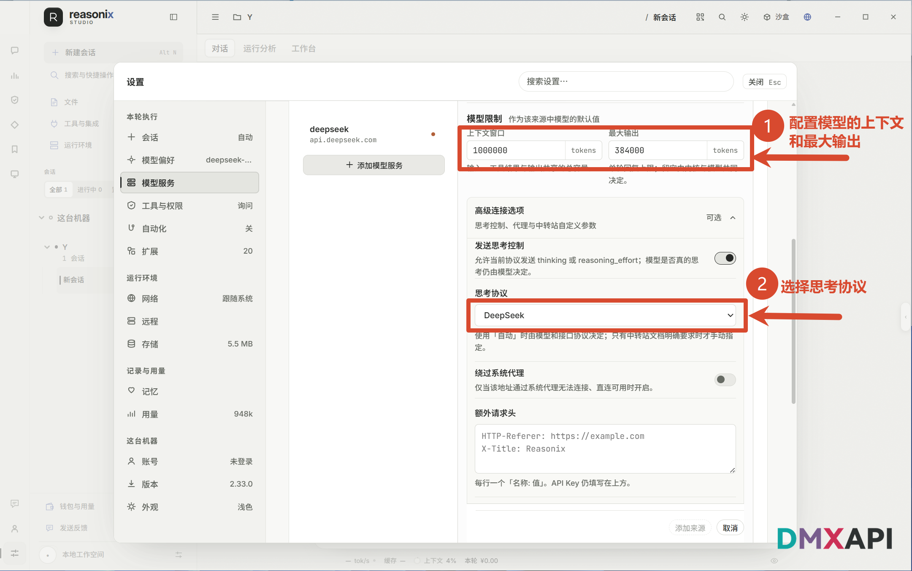

### 添加模型 ID

在「模型目录」处的输入框中填入您使用的模型名称，例如 `deepseek-v4.1-flash`，然后点击「添加未列出的模型」（按原始模型 ID 保存，添加后可以验证，不会替换成相似名称）。也可以点击「验证连接并读取」尝试从接口读取模型列表。

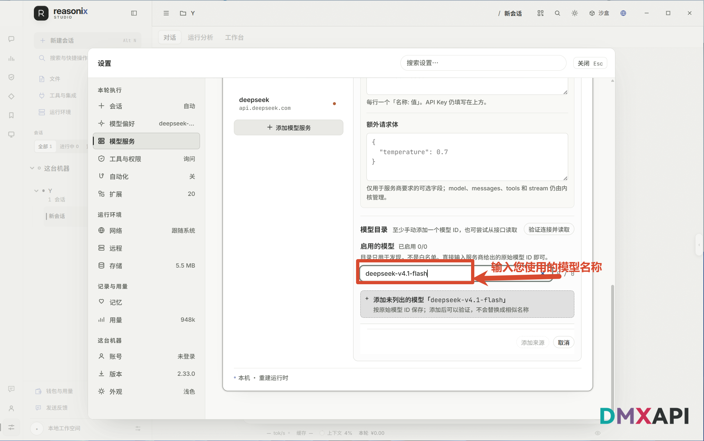

### 验证模型并添加来源

模型显示「已验证可用」后，点击底部「添加来源」保存。

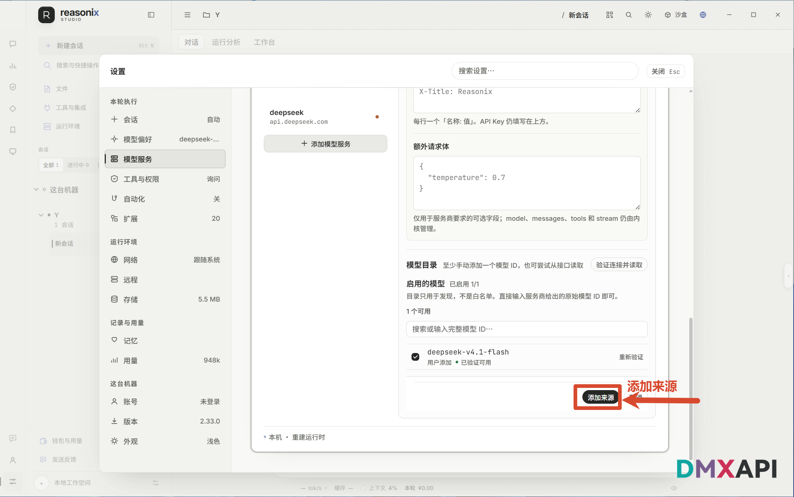

### 配置推理档位并保存

进入刚添加的来源，在「思考参数与推理档位」中：

1. **推理档位**：填写端点接受的推理强度取值，用逗号分隔，例如 `low,high,max`
2. **默认档位**：选择 `max`（推理强度选「自动」时使用的档位）
3. 点击底部「保存」

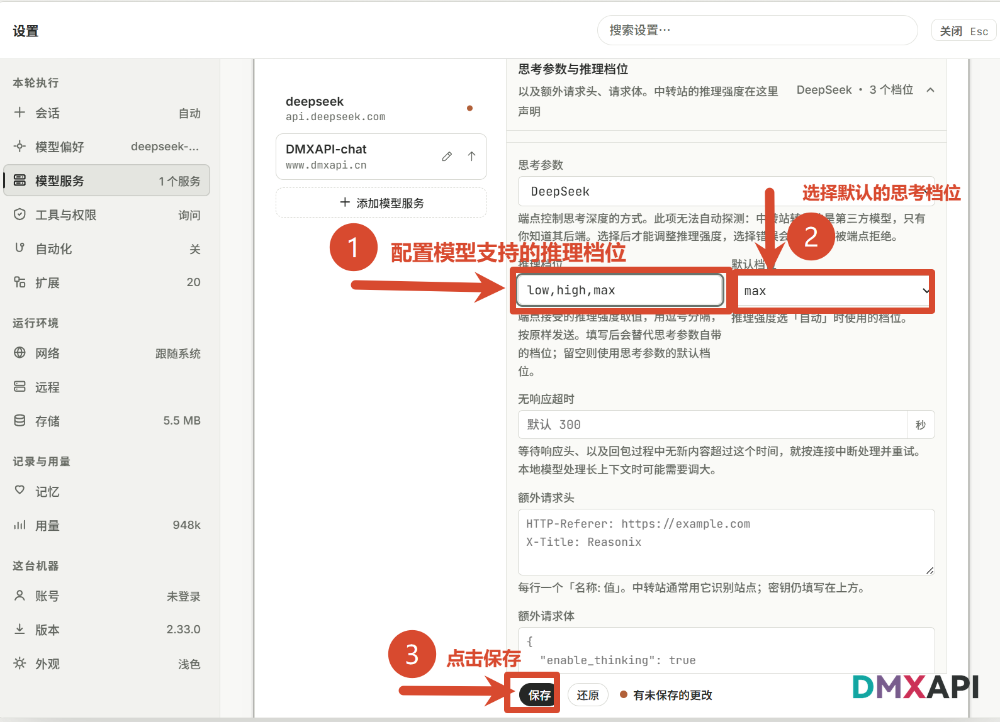

## 3. 常用模型配置 {#common-models}

以下分别演示 DeepSeek、Kimi、GLM、GPT、Claude 五类模型的完整配置。各来源的接口地址与 API Key 均相同，差异主要在**接口协议、模型限制、思考参数与推理档位**。

::: tip
- 模型支持图片输入时，记得在模型行右侧打开「读图」
- 「按模型设置限制」中留空的模型沿用来源默认值，填写后只对该模型生效
:::

## 3.1 DeepSeek 模型（OpenAI 兼容） {#deepseek}

1. **模型来源**： `DMXAPI-deepseek`、接口协议 `OpenAI 兼容`
2. **接口地址**： `https://www.dmxapi.cn/v1`，
3. **API Key**：填入 DMXAPI 密钥
4. **模型限制**：上下文窗口 `1000000`、最大输出 `384000` tokens。

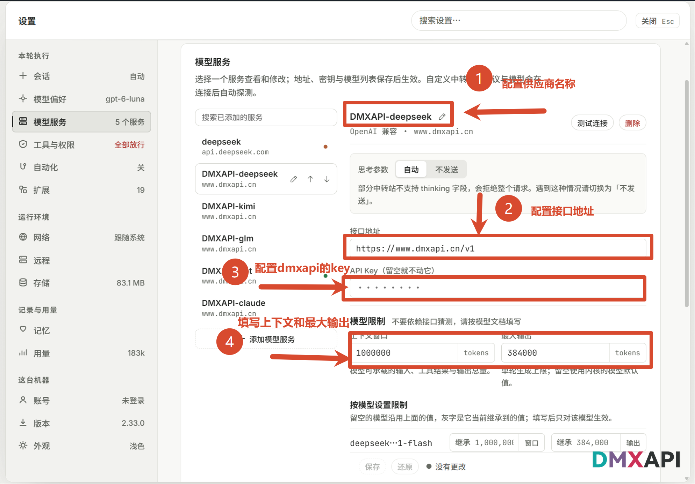

添加模型 `deepseek-v4.1-flash`、`deepseek-v4-pro-0813`，可按需为单个模型单独填写上下文和最大输出；
 支持读图的模型打开「读图」。

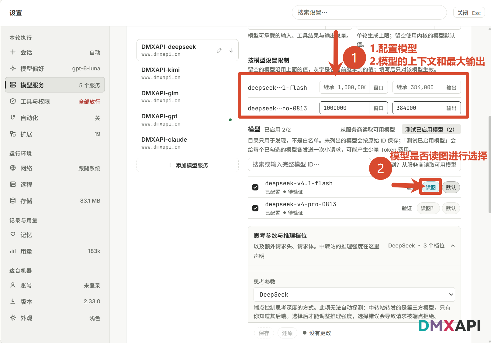

思考参数选择 `DeepSeek`，推理档位 `low, high, max`，默认档位 `max`；
 「按模型设置档位」选择「继承接入设置」，最后点击「保存」。

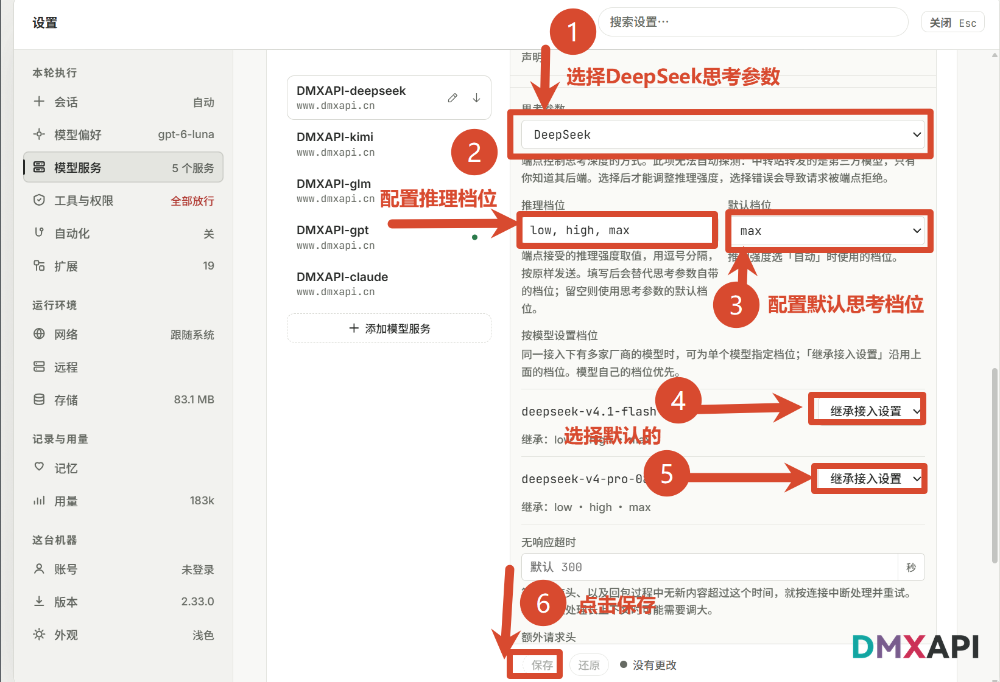

## 3.2 Kimi 模型（OpenAI 兼容） {#kimi}

1. **模型来源**： `DMXAPI-kimi`、接口协议 `OpenAI 兼容`
2. **接口地址**： `https://www.dmxapi.cn/v1`，
3. **API Key**：填入 DMXAPI 密钥
4. **模型限制**：上下文窗口 `1000000`、最大输出 `128000` tokens。

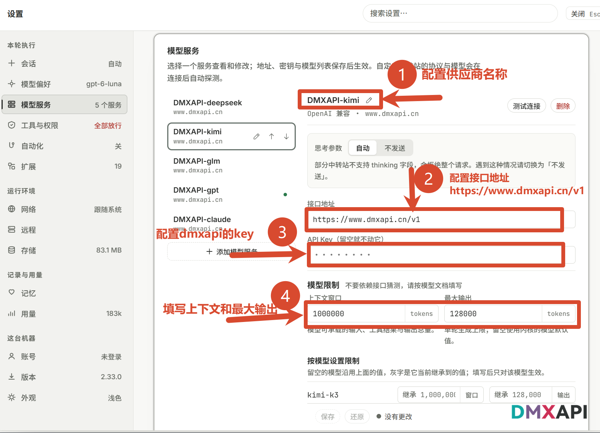

添加模型 `kimi-k3`、`kimi-k2.8-preview`，按模型设置限制保持「继承」即可；
 两个模型均支持读图，打开「读图」。

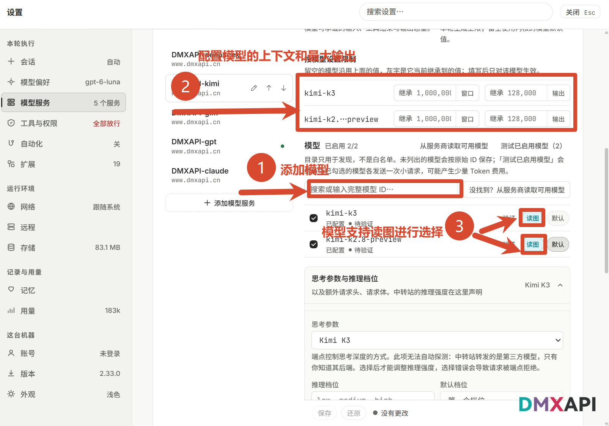

思考参数选择 `Kimi K3`（推理档位 `low, medium, high`，默认第一个档位；该思考参数不使用自定义档位）；
 「按模型设置档位」选择「继承接入设置」，最后点击「保存」。

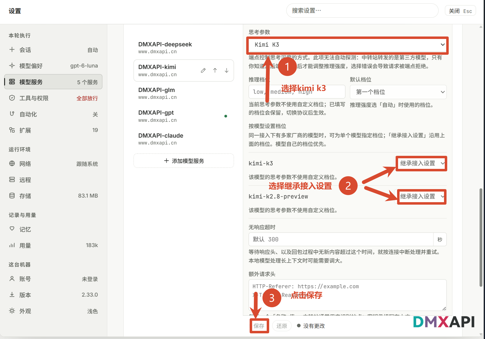

## 3.3 GLM 模型（OpenAI 兼容） {#glm}

1. **模型来源**： `DMXAPI-glm`、接口协议 `OpenAI 兼容`
2. **接口地址**： `https://www.dmxapi.cn/v1`，
3. **API Key**：填入 DMXAPI 密钥
4. **模型限制**：上下文窗口 `1000000`、最大输出 `128000` tokens。

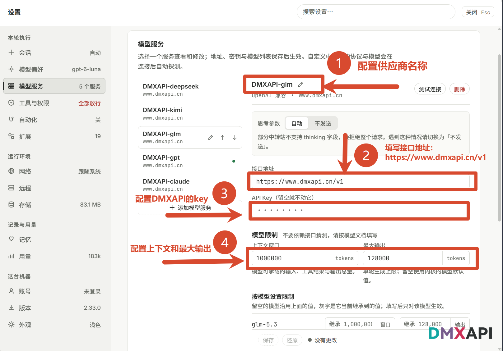

添加模型 `glm-5.3`、`glm-5.3-flash`，按模型设置限制保持「继承」即可；
 支持读图的模型打开「读图」。

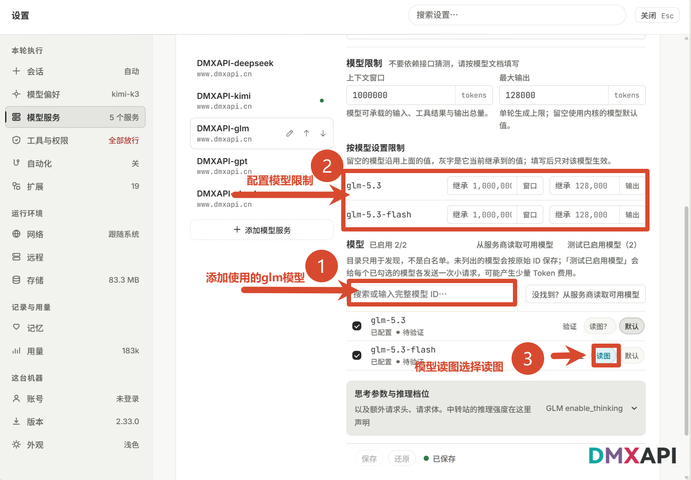

思考参数选择 `GLM enable_thinking`；
 「按模型设置档位」需选择「单独设置」，为每个模型勾选支持的思考等级 `low`、`high`、`max`，默认档位选 `max`（`glm-5.3` 与 `glm-5.3-flash` 配置相同），最后点击「保存」。

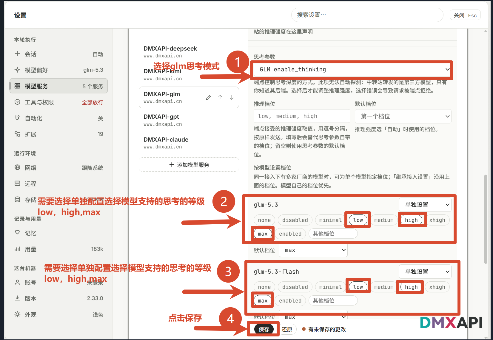

## 3.4 GPT 模型（Responses 协议） {#gpt}

1. **模型来源**： `DMXAPI-gpt`、接口协议 `Responses`
2. **接口地址**： `https://www.dmxapi.cn/v1`，
3. **API Key**：填入 DMXAPI 密钥
4. **模型限制**：上下文窗口 `1000000`、最大输出 `128000` tokens。

::: tip
Responses 协议的「上下文续接」保持「自动」即可；
:::

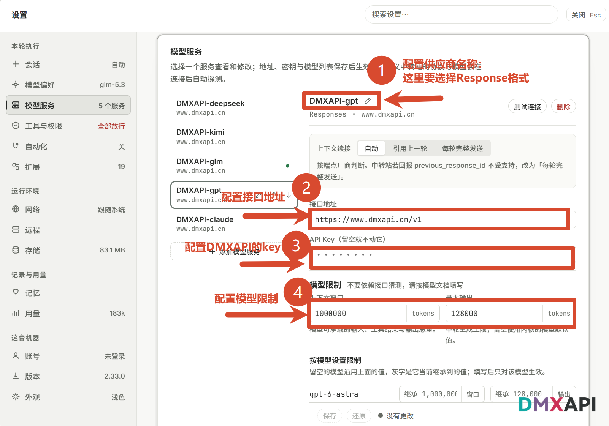

添加模型 `gpt-6-astra`、`gpt-6-sol`、`gpt-6-luna`、`gpt-5.6-terra`、`gpt-6.1-sol`；这些模型与继承配置一致，按模型设置限制无需修改。

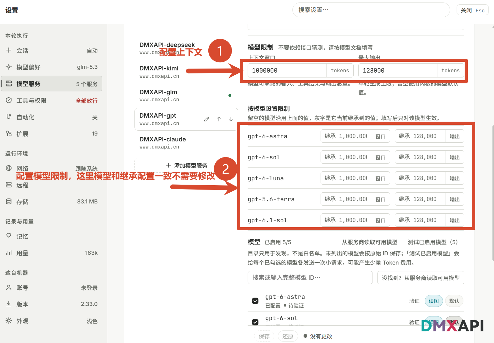

思考参数选择 `OpenAI reasoning_effort`；「按模型设置档位」需选择「单独设置」，勾选各模型支持的思考等级：

- `gpt-6-astra`：勾选 `low`、`medium`、`high`、`xhigh`、`max`，默认档位 `max`
- `gpt-6-sol`：勾选 `none`、`low`、`medium`、`high`、`xhigh`、`max`，默认档位 `none`（第一个档位）

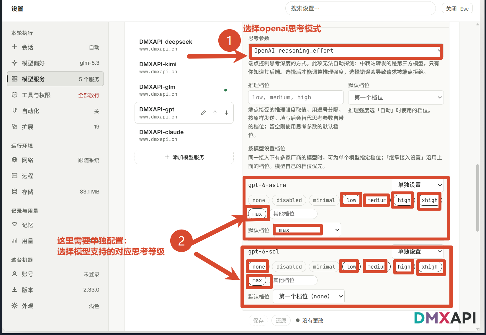

继续为其余模型单独配置思考等级：

- `gpt-6-luna`：勾选 `none`、`low`、`medium`、`high`、`xhigh`，默认档位 `none`（第一个档位）
- `gpt-5.6-terra`：勾选 `none`、`low`、`medium`、`high`、`xhigh`、`max`，默认档位 `none`（第一个档位）
- `gpt-6.1-sol`：勾选 `low`、`medium`、`high`、`xhigh`、`max`，默认档位 `low`（第一个档位）

配置完成后点击「保存」。

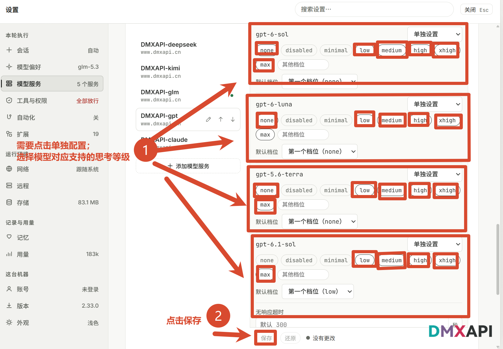

## 3.5 Claude 模型（Anthropic 兼容） {#claude}

1. **模型来源**： `DMXAPI-claude`、接口协议 `Anthropic 兼容`
2. **接口地址**： `https://www.dmxapi.cn/v1`，
3. **API Key**：填入 DMXAPI 密钥
4. **模型限制**：上下文窗口 `1000000`、最大输出 `128000` tokens。

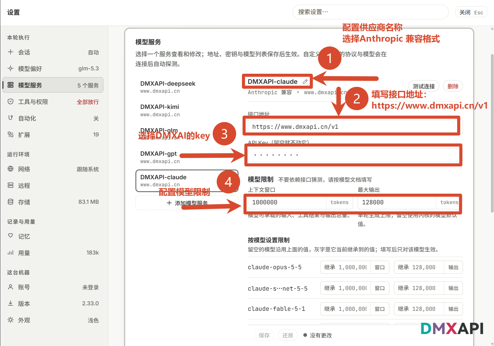

添加模型 `claude-opus-5-5`、`claude-sonnet-5-5`、`claude-fable-5-1`、`claude-haiku-5-5-cc`；
 Claude 模型的限制保持「继承」即可，无需修改；4 个模型均打开「读图」。

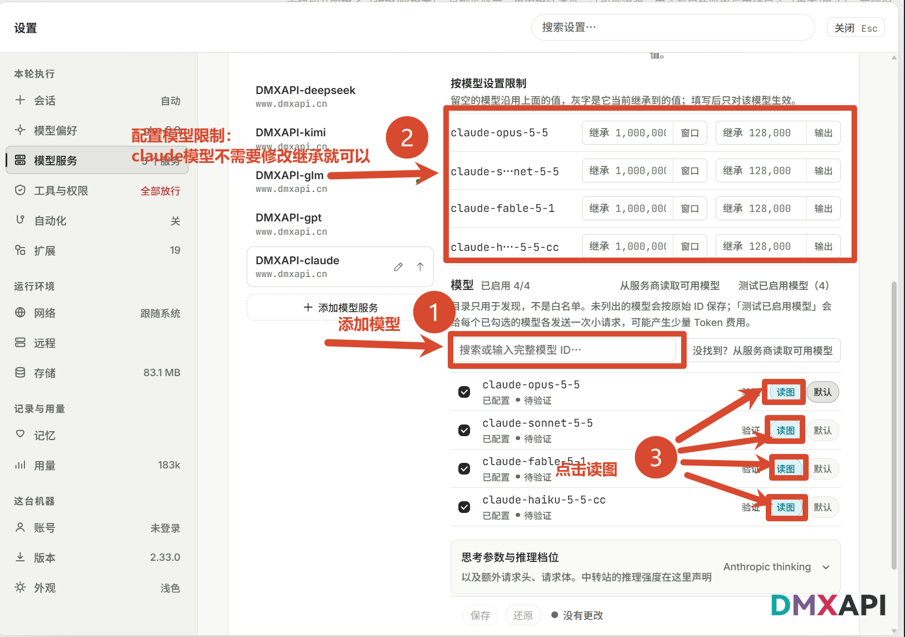

思考参数选择 `Anthropic thinking`（推理档位 `low, medium, high`，默认第一个档位）；
 「按模型设置档位」选择「继承接入设置」即可，最后点击「保存」。

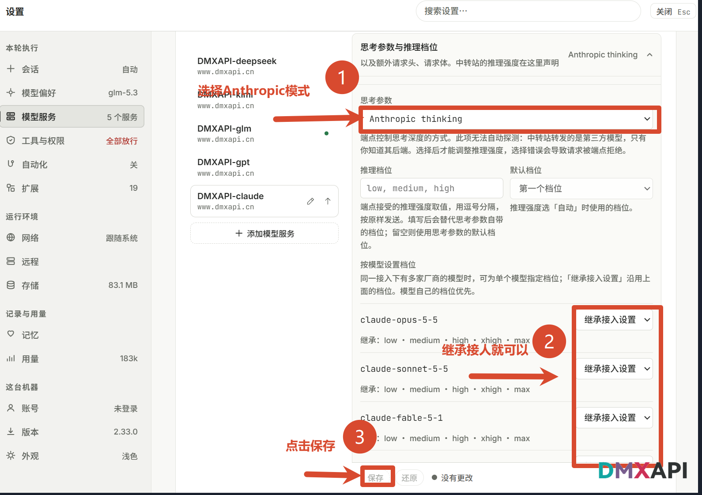

配置完成后，回到主界面点击「打开项目…」，在底部输入框右侧的模型选择处切换到刚配置好的模型，发送消息正常回复即表示配置成功，可以开始使用 Reasonix Studio 进行 AI 编程。

  <small>© 2026 DMXAPI Reasonix Studio 配置教程</small>

