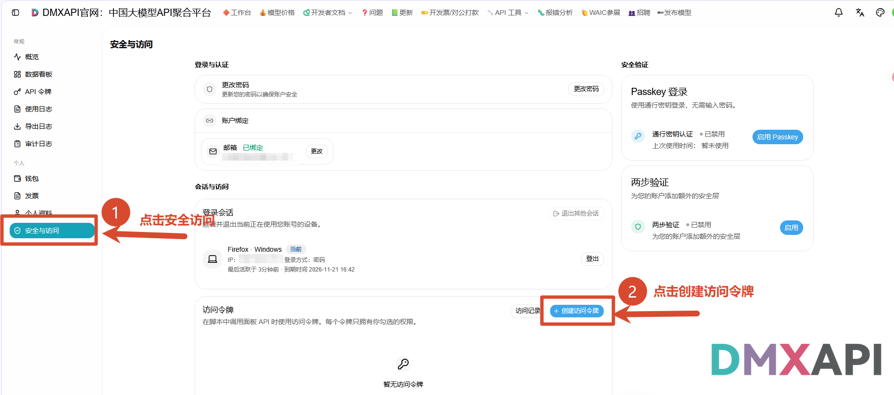
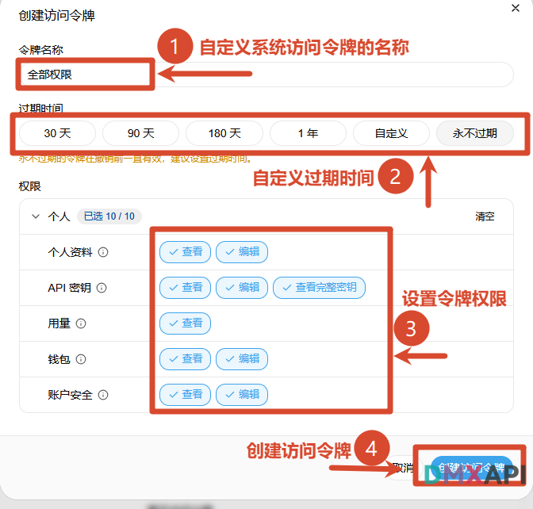
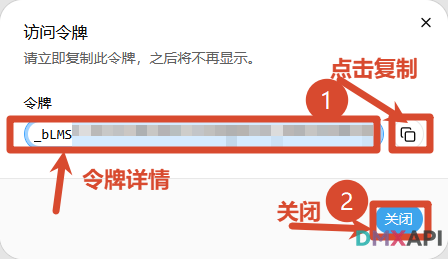
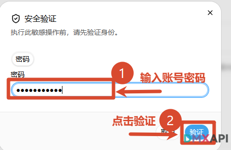
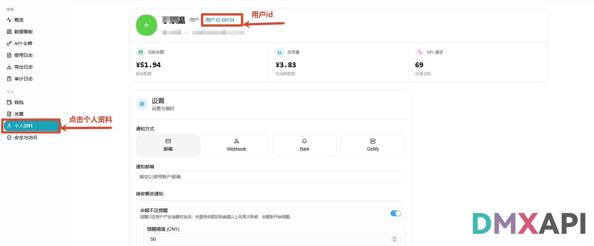

# 如何创建系统令牌和查找用户ID

调用平台管理接口时需要两个关键参数：**系统令牌（SYSTEM_TOKEN）** 和 **用户 ID（USER_ID）**。本文演示如何在 DMXAPI 后台获取这两个参数。

::: warning 不要混用
系统访问令牌用于账户管理接口，不是调用模型使用的 `sk-...` API Key。
:::

## 查询网址
```
https://www.dmxapi.cn/profile
```

## 一、创建系统令牌

### 1. 进入「安全与访问」

登录 DMXAPI 工作台，点击左侧菜单的 **安全与访问**，在页面底部「访问令牌」区域点击 **+ 创建访问令牌**。



### 2. 设置令牌信息

在「创建访问令牌」弹窗中：

1. 「令牌名称」自定义一个便于识别的名称；
2. 「过期时间」可选 30 天、90 天、180 天、1 年、自定义或永不过期；
3. 「权限」按需勾选，权限决定该令牌可调用的管理接口范围（例如调用令牌管理接口需勾选「API 密钥」权限）。

设置完成后点击「创建访问令牌」。



### 3. 完成安全验证

创建令牌属于敏感操作，在「安全验证」弹窗中输入账号密码，点击「验证」。



### 4. 复制系统访问令牌

验证通过后系统会生成令牌，点击复制按钮将令牌复制备用。

::: warning 注意
令牌仅在创建时显示一次，关闭弹窗后无法再次查看完整令牌，请立即复制并妥善保管，不要与他人分享。如有遗失，可在令牌列表中撤销后重新创建。
:::



:::tip 提示
令牌的编辑、访问记录查看、撤销等管理操作及更详细的图文步骤，见 [系统访问令牌教程](/system-key)。
:::

## 普通令牌管理接口认证头

创建令牌、获取所有令牌、搜索令牌、更新令牌和删除令牌时，使用下面的认证头：

```http
Authorization: Bearer YOUR_SYSTEM_TOKEN
Dmx-Api-User: YOUR_USER_ID
```

其中 `Authorization` 和 `Dmx-Api-User` 是请求头的变量名，保持不变；只需将 `YOUR_SYSTEM_TOKEN` 和 `YOUR_USER_ID` 分别替换为你自己的系统令牌和用户 ID。

## 二、查看用户 ID

点击左侧菜单的 **个人资料**，页面顶部的「用户 ID」即为你的 USER_ID。



<p align="center">
  <small>© 2026 DMXAPI 如何创建系统令牌和查找用户ID</small>
</p>
