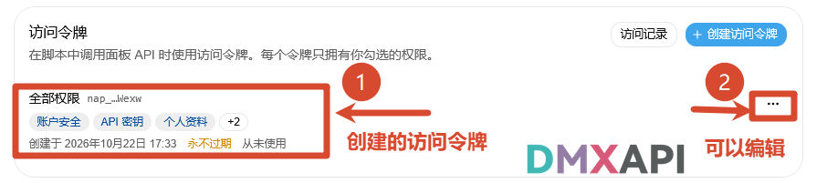
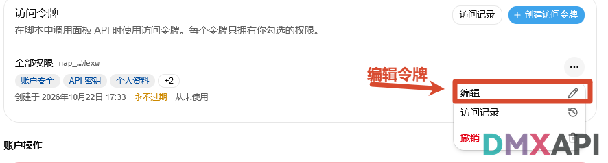
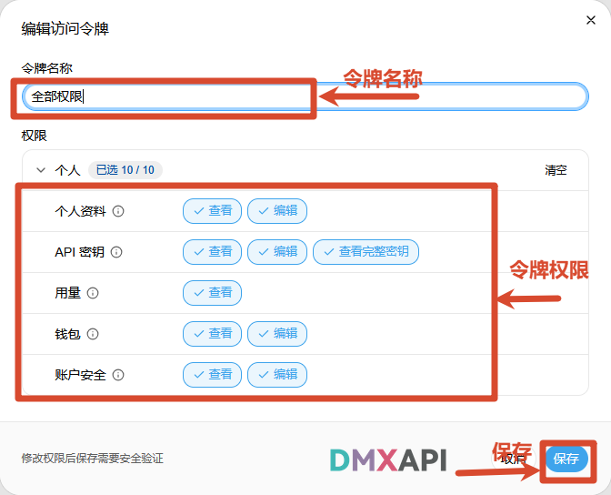

# DMXAPI 系统访问令牌教程

系统访问令牌用于在脚本中调用 DMXAPI 面板 API（如查询用量、管理密钥等管理类接口），每个令牌只拥有你勾选的权限。它与调用模型 API 的「API 令牌 Key」不同，请注意区分。本文介绍在 DMXAPI 官网创建、查看和编辑系统访问令牌的完整流程。

## 创建访问令牌

### 1. 进入「安全与访问」页面

登录 [DMXAPI 官网](https://www.dmxapi.cn/) 工作台，点击左侧菜单的「安全与访问」，在页面底部「访问令牌」区域点击「+ 创建访问令牌」。

### 2. 设置令牌信息

在「创建访问令牌」弹窗中：

1. 「令牌名称」自定义一个便于识别的名称；
2. 「过期时间」可选 30 天、90 天、180 天、1 年、自定义或永不过期（永不过期的令牌在撤销前一直有效，建议设置过期时间）；
3. 「权限」按需勾选该令牌可使用的权限，如个人资料、API 密钥、用量、钱包、账户安全等，每项可分别授予查看、编辑权限。

设置完成后点击「创建访问令牌」。

### 3. 完成安全验证

创建令牌属于敏感操作，需先验证身份：在「安全验证」弹窗中输入账号密码，点击「验证」。

### 4. 复制并保存令牌

验证通过后，系统会生成访问令牌。请立即点击复制按钮复制该令牌，之后将不再显示，务必妥善保存，然后点击「关闭」。

:::warning 注意
令牌仅在创建时显示一次，关闭弹窗后无法再次查看完整令牌，如有遗失只能重新创建。
:::

### 5. 查看已创建的令牌

创建完成后，令牌会显示在「访问令牌」列表中，可查看令牌名称、权限范围、创建时间、过期时间和使用情况。点击令牌右侧的「…」可对该令牌进行管理。

## 编辑访问令牌

### 1. 打开令牌管理菜单

在「访问令牌」列表中，点击目标令牌右侧的「…」，选择「编辑」。该菜单中还可选择「访问记录」查看令牌的调用记录，或选择「撤销」将该令牌作废。

### 2. 修改并保存

在「编辑访问令牌」弹窗中，可修改「令牌名称」和「权限」范围，确认无误后点击「保存」。注意：修改权限后保存需要进行安全验证（输入账号密码）。

---

  <small>© 2026 DMXAPI 系统访问令牌教程</small>

