# WorkBuddy 配置 DMXAPI 使用教程

WorkBuddy 是腾讯推出的 AI 桌面智能体，支持自然语言驱动本地任务执行。通过配置 DMXAPI 自定义模型，可以在 WorkBuddy 中接入 Deepseek、Kimi、GLM 等主流模型，充分发挥其文档处理、数据分析、自动化办公等能力。

## 下载安装

前往 WorkBuddy 官网下载客户端，支持 Windows 和 macOS：

👉 **[https://copilot.tencent.com/work/](https://copilot.tencent.com/work/)**

## 配置 DMXAPI 模型

### 第一步：打开设置

启动 WorkBuddy 后，点击左下角头像区域旁的 「>」 按钮展开侧边菜单，在菜单中点击「设置」进入设置页面。

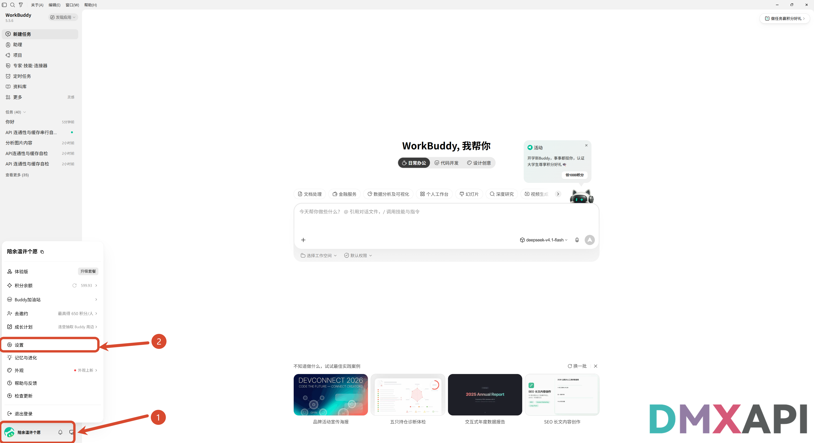

### 第二步：进入模型管理，点击添加模型

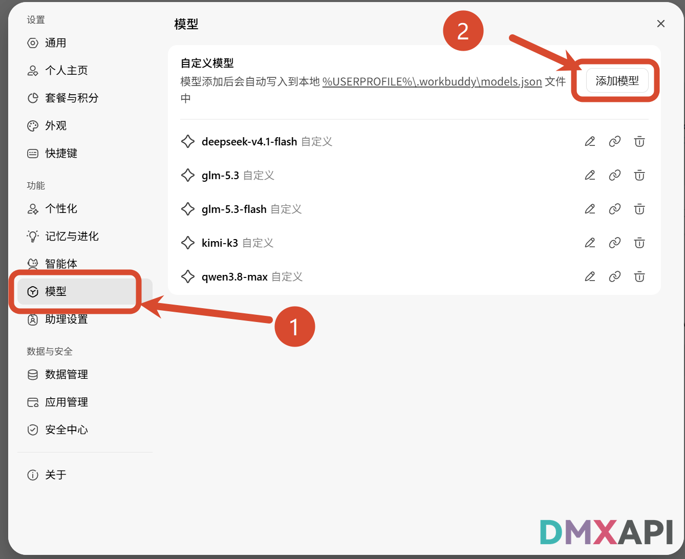

### 第三步：选择自定义提供商

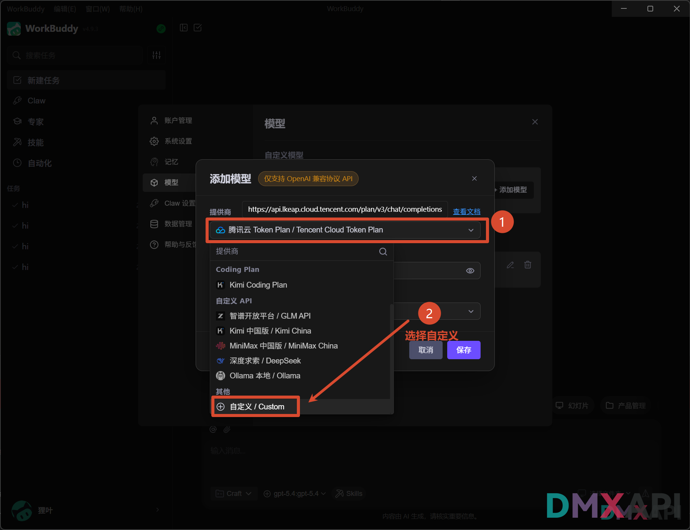

### 第四步：填写接口地址和 API Key

选择自定义后，先填写接入 DMXAPI 所需的两项信息：

- ① **接口地址**：填写 `https://www.dmxapi.cn/v1`
- ② **API Key**：填入您的 DMXAPI key，可在 DMXAPI 网站「工作台 → API 令牌」处获取

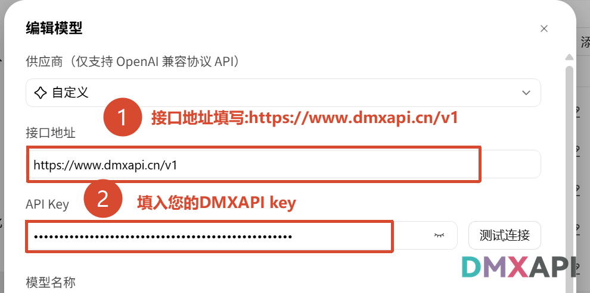

### 第五步：配置模型参数

继续向下滚动，按下图配置模型参数（以 `kimi-k3` 为例），完成后点击「保存」：

- ① **模型名称**：填写要使用的模型名，请先在 DMXAPI 网站顶部「模型价格」页面确认模型存在，确认无误后直接复制粘贴
- ② **高级配置**：按模型实际能力勾选「工具调用」「图片输入」「思考模式」「仅思考模式」「允许关闭思考」，「自定义协议」保持不勾选
- ③ **支持的思考强度**：勾选该模型支持的思考强度档位，「默认思考强度」保持「自动」即可
- ④ **输入 / 输出**：分别填写模型的上下文长度和最大输出 token 数

各模型的具体取值见下文 [常用模型配置](#常用模型配置)。

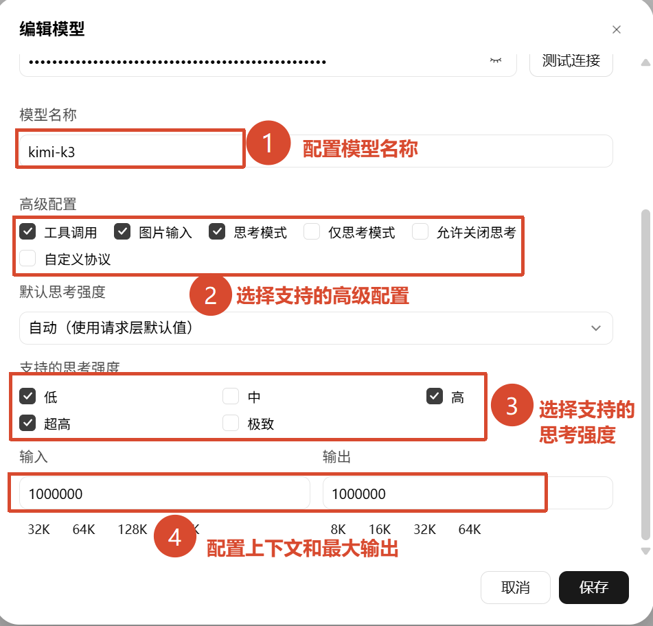

## 选择模型并测试

### 第六步：切换到自定义模型

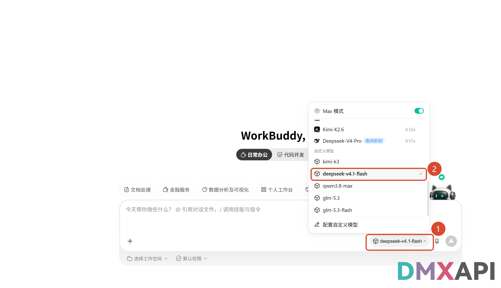

### 第七步：发送消息测试
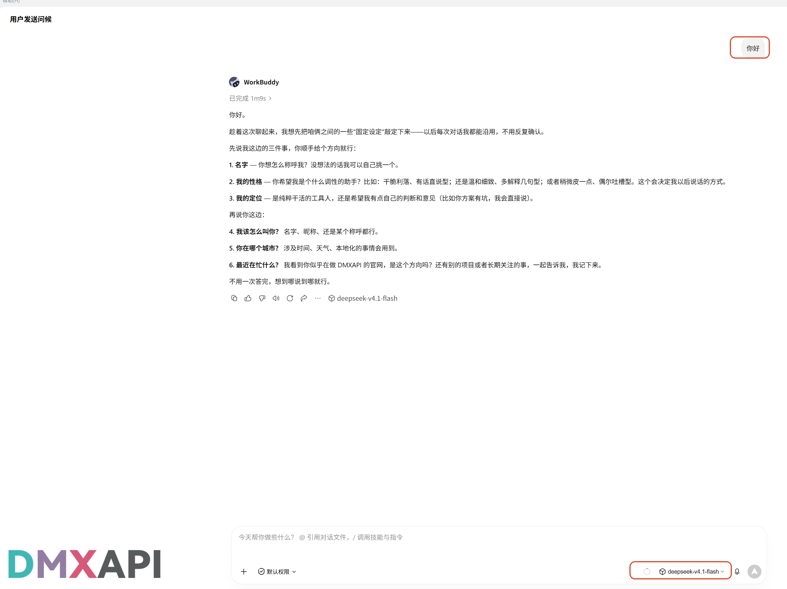

## 常用模型配置
## kimi-k3模型配置

## deepseek-v4.1-flash
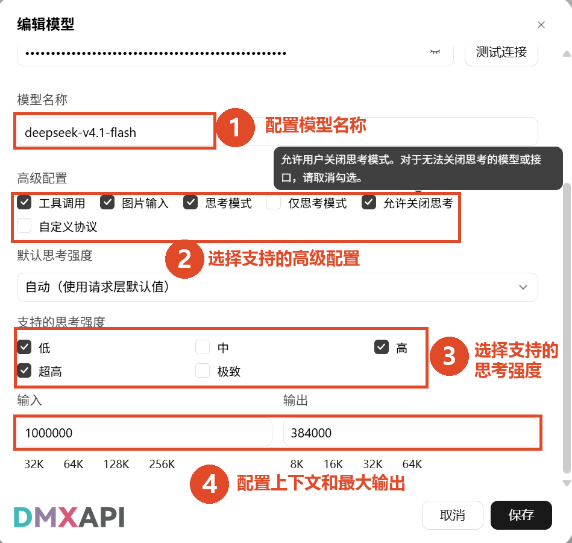
## glm-5.3
不支持图片输入，请勿勾选「图片输入」；需同时勾选「思考模式」和「仅思考模式」；不支持关闭思考
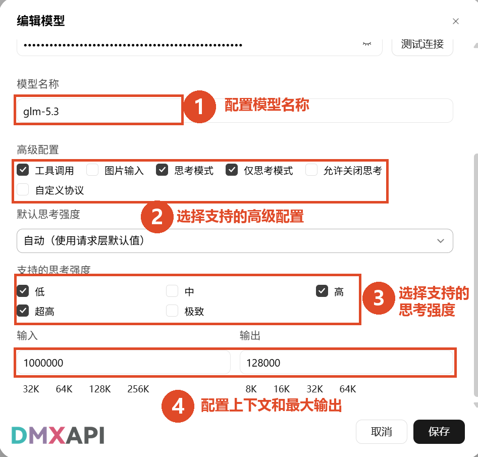
## qwen3.8-max
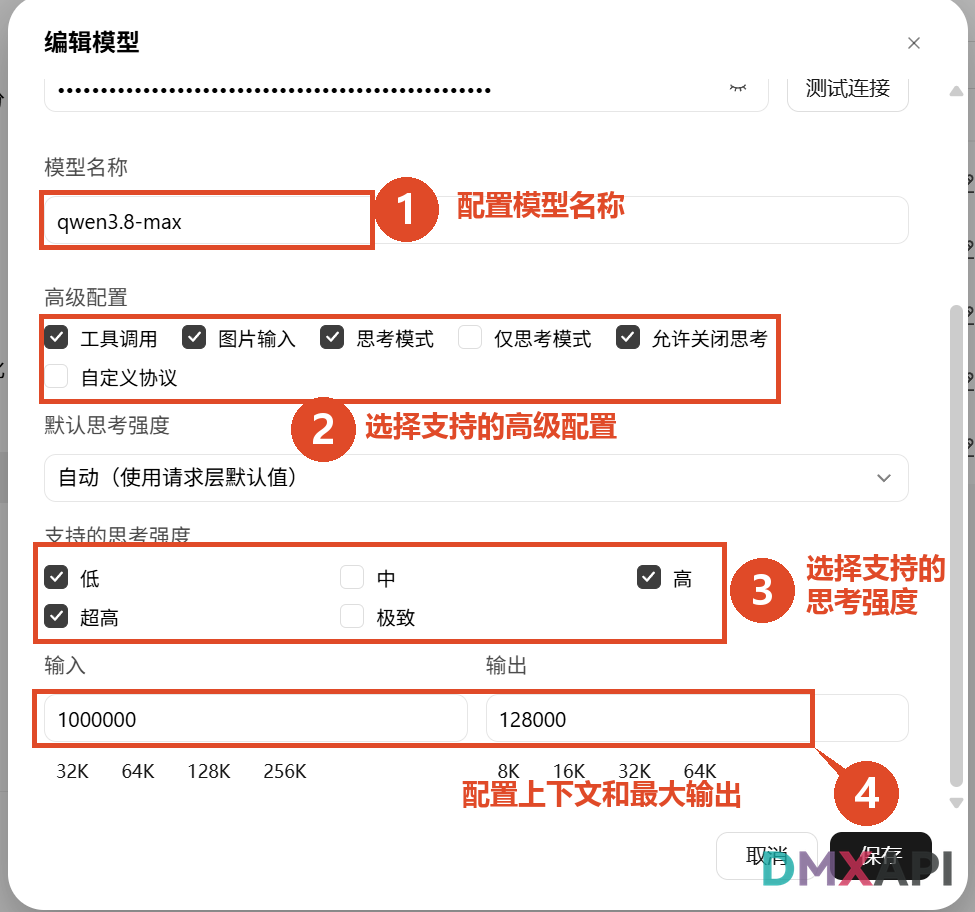
## glm-5.3-flash
支持工具调用和图片输入，需同时勾选「思考模式」和「仅思考模式」；不支持关闭思考
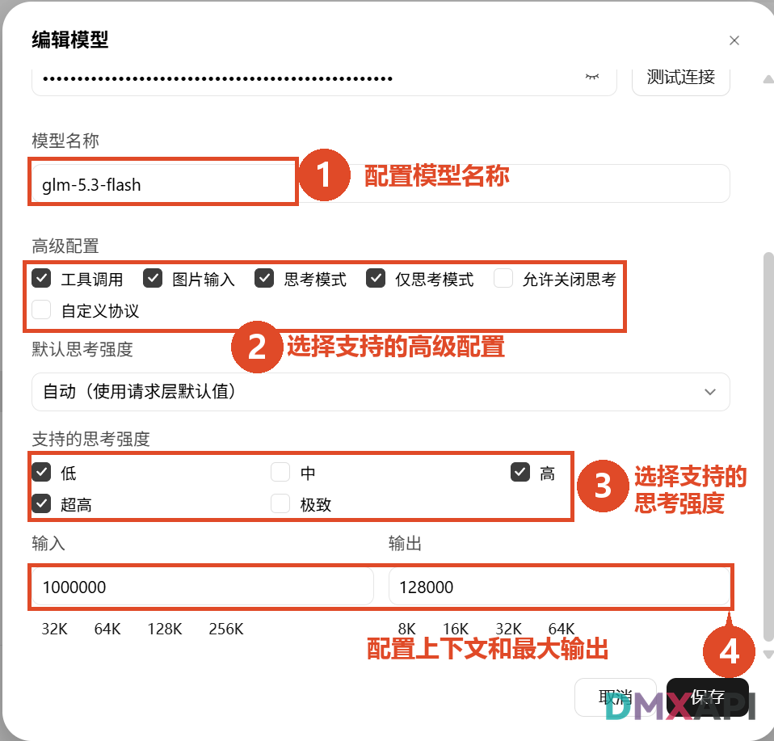

## 连接手机端（可选）

WorkBuddy 内置 **Claw** 功能，支持将 AI 能力接入微信小程序、微信 ClawBot、微信客服号、企微 AIBot 等渠道，实现用手机远程触发、控制电脑执行任务。

点击顶部工具栏右侧的 ① 齿轮图标，进入「Claw 设置」，在 ② 各集成入口旁点击「配置指南」，按官方文档完成绑定配置。

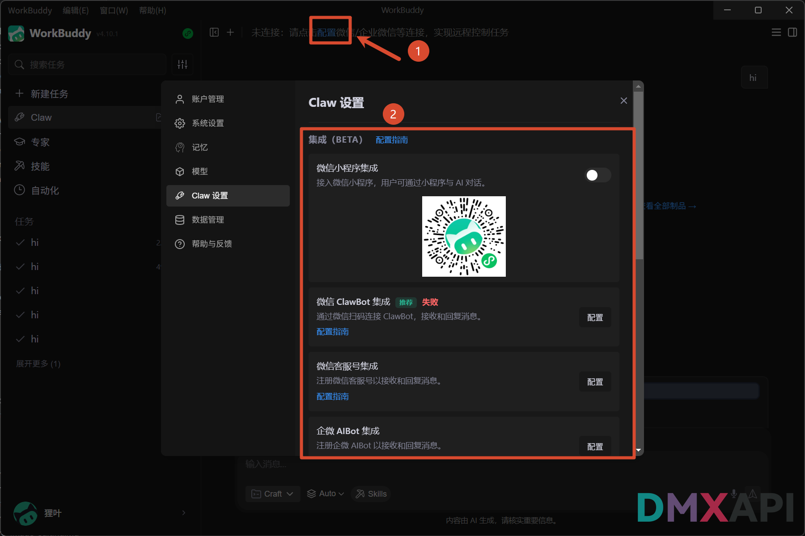

  <small>© 2026 DMXAPI WorkBuddy 配置教程</small>

