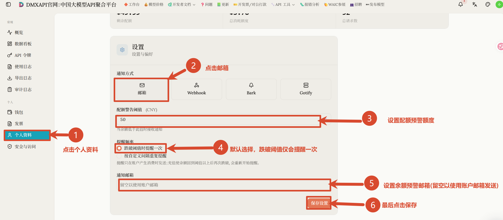
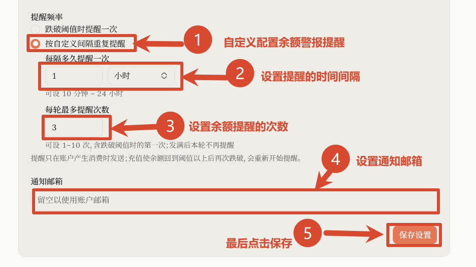

# DMXAPI 余额警告教程

账户余额不足会导致 API 调用失败。DMXAPI 支持设置余额预警：当账户余额低于你设定的阈值时，系统会自动发送邮件提醒，方便你及时充值，避免线上服务中断。本文介绍如何在工作台配置邮箱余额提醒。

## 设置入口

登录 [DMXAPI 官网](https://www.dmxapi.cn/)，进入工作台，点击左侧菜单的「个人资料」，在页面下方找到「设置」区域即可配置。

## 设置方法（跌破阈值提醒一次）

按下图编号顺序操作：

1. 点击左侧菜单「个人资料」；
2. 「通知方式」选择「邮箱」；
3. 「配额警告阈值（CNY）」填写预警额度，例如 50，当余额低于此值时接收通知；
4. 「提醒频率」保持默认的「跌破阈值时提醒一次」，余额跌破阈值后只会提醒一次；
5. 「通知邮箱」填写接收提醒的邮箱，留空则默认发送到账户注册邮箱；
6. 最后点击「保存设置」。

## 按自定义间隔重复提醒

如果希望余额跌破阈值后持续收到提醒，可以改用自定义间隔：

1. 「提醒频率」选择「按自定义间隔重复提醒」；
2. 「每隔多久提醒一次」设置提醒的时间间隔，可设 10 分钟 ~ 24 小时；
3. 「每轮最多提醒次数」设置本轮最多提醒几次，可设 1 ~ 10 次（含跌破阈值时的第一次），发满后本轮不再提醒；
4. 「通知邮箱」填写接收提醒的邮箱，留空则使用账户邮箱；
5. 最后点击「保存设置」。

:::tip 提示
- 提醒只在账户产生消费时发送；充值使余额回到阈值以上后再次跌破，会重新开始提醒。
:::

---

  <small>© 2026 DMXAPI 余额警告教程</small>

